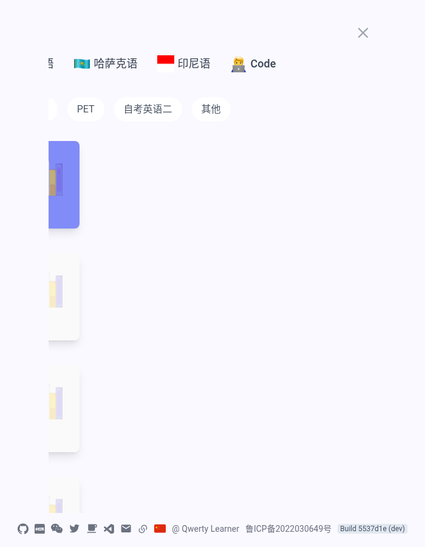
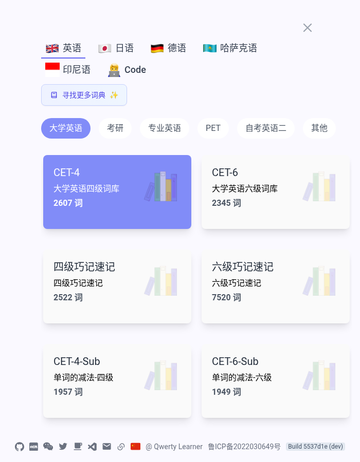

# 实战：用 dcl 修复开源项目 Issue

本文记录用 `dcl` + DeepSeek `deepseek-flash` 修复 [qwerty-learner #1095](https://github.com/RealKai42/qwerty-learner/issues/1095)（修好 Tauri 桌面端，并修复几个 Web 端 bug）的完整过程，可作为用 dcl 处理真实仓库任务的参考流程。日期：2026-10-21。

## 准备

```bash
git clone git@github.com:litongjava/qwerty-learner.git
cd qwerty-learner
git checkout -b fix/issue-1095
yarn install --frozen-lockfile        # 让 dcl 能运行 tsc / eslint / prettier

export DEEPSEEK_API_KEY=<你的 API Key>
export DEEPSEEK_BASE_URL=https://api.deepseek.com/anthropic
```

## 拆分任务

Issue 是一份多项提案。把它拆成**可以单独验证、单独提交**的小任务，每个任务一个提示词文件，明确：

- 背景（引用 issue 原文中的问题描述）；
- 要改什么、不能改什么（"Do not modify any other file"）；
- 验证命令和期望结果（例如"tsc 不新增错误，HEAD 上已有 4 个错误"）；
- "Do not commit"，由人审查 diff 后提交。

| 任务 | 内容 | 验证 |
|---|---|---|
| t1 | `.gitattributes` 补齐 `icns`/`jpg`/`mp3` 等二进制声明 | `git check-attr -a` |
| t2 | 缩放窗口时只有跨越移动端断点才重载页面 | tsc、eslint、prettier |
| t3 | 发音请求 URL 转义（下划线转空格 + `encodeURIComponent`） | tsc、eslint，curl 实测有道接口 |
| t4 | 桌面端升级 Tauri 2、接入 `@tauri-apps/cli`、修正 dev 端口与 Cargo 元数据 | `tauri --version`、`cargo build`、`tauri info`、tsc |
| t5 | 词典页内容列两侧溢出、左侧被裁掉 | Playwright 在 700/1440 宽度截图并测量元素坐标 |

## 运行

每个任务用同一个脚本运行，并保存完整事件流：

```bash
dcl -m deepseek-flash --api-format anthropic \
  --dangerously-skip-permissions --output-format stream-json --verbose --max-turns 120 \
  -p "$(cat t4.prompt)" < /dev/null > t4.jsonl 2> t4.err
```

- `--dangerously-skip-permissions` 只在可丢弃的工作副本里使用；dcl 的安全过滤仍会拦截危险命令（本次 `rm -rf /tmp/...` 被拦截）。
- 大任务（t4 包含 Rust 编译）可能超过 10 分钟，外层超时要留足；t4 曾因外层 600 秒超时在最后一步被终止，所幸所有验证已完成。
- 用 `jq` 或小脚本从 `t4.jsonl` 提取 `tool_start` / `tool_result` / `result` 审查过程。

## 结果

| 任务 | 工具调用 | 结果 |
|---|---|---|
| t1 | 8 | 补齐 12 种二进制扩展名，`icon.icns` 由 `text: set` 变为 `binary: set` |
| t2 | 11 | 用 `useRef` 记录上次布局，只有 mobile → desktop 时跳转；先还原到 HEAD 跑基线确认未新增类型错误 |
| t3 | 26 | 抽出 `toAudioQueryValue`，覆盖全部 8 个语种分支；`Machine_Learning` 由 500 变 200，`R&D` 不再截断 |
| t4 | 24 | `tauri-cli 2.12.3`，`cargo build` 通过，`tauri info` 显示 `devUrl: http://localhost:5173/`、`frontendDist: ../build` |

| t5 | 44 | 内容列限制在视口内、标签行换行、卡片改为 auto-fill 网格；700 宽度下首个语言标签 x 由 -193 变为 80 |

t4 中模型自行处理了旧 `Cargo.lock` 里 `time 0.3.30` 与新编译器不兼容的问题（先 `cargo update -p time`，再重新生成锁文件）。

t5 由 dcl 自己启动 Vite、编写 Playwright 脚本截图并测量。700 像素宽度下修复前后对比：

| 修复前 | 修复后 |
|---|---|
|  |  |

Playwright 自带浏览器版本未安装时，在提示词中给出已缓存的 Chromium 路径（`chromium.launch({ executablePath })`）即可。

## 未在本次处理的部分

Issue 中的以下内容需要 macOS 环境或维护者决策，本次没有处理：macOS 快捷键与深色模式适配、发音本地缓存（Rust 自定义 scheme）、通用二进制与 CI 发布流程、替换应用图标，以及 issue 末尾向维护者提出的问题。

## 过程中发现并修复的 dcl 问题

| 问题 | 现象 | 修复 |
|---|---|---|
| stdin 管道不关闭时永久阻塞 | 在代理工具中运行 `dcl -p` 无输出、不退出 | 最多等待 3 秒首字节，见[非交互模式](./non-interactive.md#标准输入) |
| 并行工具调用在 DeepSeek 上 400 | 模型同时调用 Read 和 Bash 后报 `tool_use ids were found without tool_result` | 同一轮工具结果合并为一条 user 消息，发送前合并相邻同角色消息，见[故障排查](./troubleshooting.md#tool-use-ids-were-found-without-tool-result) |

## 经验

- 提示词里写清"已有错误基线"，模型会主动对比，而不是去修无关错误。
- 要求模型"不提交"，由人审查 diff；本次五个任务的 diff 都无需返工。
- 记录 `stream-json` 事件流，出现接口错误时能直接定位到哪一次请求、哪一个工具调用。
