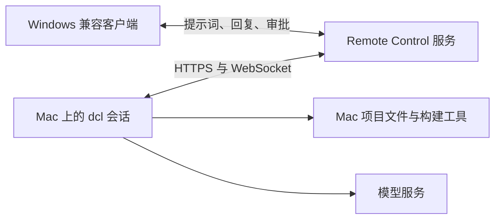

# 在 Windows 上用 dcl 远程开发 macOS 程序

你可以在 Windows 上使用 dcl 修改项目，通过 SSH 在一台 Mac 上编译、测试和打包。macOS SDK、Xcode、签名证书以及 GUI 验收都位于 Mac；Windows 是操作入口。需要一台可通过网络访问的真实 Mac 或 macOS 构建主机。

本文按当前 CLI 的参数与实现编写。示例中的主机、账号、仓库和项目目录需要替换；没有在你的 Mac 上完成实机验收。

## 选择工作方式

| 方式 | dcl 运行位置 | 适合的情况 |
|---|---|---|
| Windows dcl + `dcl ssh` | Windows | Windows 编辑代码，Mac 负责构建、测试和打包；本文主线 |
| Windows SSH 终端 + Mac dcl | macOS | 希望模型直接读写 Mac 文件、调用 Mac 工具，交互式开发更直接 |
| Mac dcl + `/remote-control` | macOS | 已有兼容的 Remote Control 服务和客户端，希望从 Windows 接入 Mac 上的会话 |

`dcl remote` 是 HTTP 请求工具，不是远程桌面或 SSH 开发环境。`/remote-control` 本身也不会把 Windows 的工具执行搬到 Mac。它控制现有会话；要在 Mac 上操作文件，该会话就必须运行在 Mac。

## 1. 准备 Mac

在 macOS 的「系统设置 → 通用 → 共享」开启「远程登录」，允许开发账号登录。记录 Mac 的 IP 地址和账号短名称，例如 `192.168.1.50`、`dev`。跨网络时先通过 VPN 或其他受控网络建立可达性。

在 Mac 的终端安装命令行开发工具：

```bash
xcode-select --install
```

如果开发 SwiftUI、Xcode 工程或需要完整 Apple SDK，安装完整 Xcode，首次打开完成组件安装与许可确认，再选择开发目录：

```bash
sudo xcode-select --switch /Applications/Xcode.app/Contents/Developer
xcodebuild -version
xcrun --sdk macosx --show-sdk-path
uname -m
```

Apple Silicon 通常输出 `arm64`，Intel Mac 通常输出 `x86_64`。Tauri 项目还需要项目要求的 Node.js、Rust 和前端依赖；以目标项目 README 和锁文件为准。

## 2. 从 Windows 配置 SSH

在 PowerShell 检查 OpenSSH 客户端：

```powershell
ssh -V
Get-Command ssh, scp
```

若未安装，在 Windows「可选功能」中添加 OpenSSH 客户端。准备一把专用密钥；下面的目标文件已存在时，不要覆盖已有密钥：

```powershell
ssh-keygen -t ed25519 -f "$env:USERPROFILE/.ssh/id_ed25519_mac_dev"
Get-Content "$env:USERPROFILE/.ssh/id_ed25519_mac_dev.pub"
```

将公钥追加到 Mac 开发账号的 `~/.ssh/authorized_keys`，不要覆盖其中其他公钥。在 Mac 上设置：

```bash
chmod 700 ~/.ssh
chmod 600 ~/.ssh/authorized_keys
```

第一次用交互式 SSH 连接，核对 Mac 主机密钥指纹后接受，写入 Windows 的 `known_hosts`：

```powershell
ssh -i "$env:USERPROFILE/.ssh/id_ed25519_mac_dev" dev@192.168.1.50
```

Mac 上可用以下命令查看对应的 ED25519 主机指纹：

```bash
ssh-keygen -lf /etc/ssh/ssh_host_ed25519_key.pub
```

如果私钥带口令，先在 Windows 配置并启动 OpenSSH Authentication Agent 服务，再通过 `ssh-add` 加载密钥。确认无交互认证可以成功：

```powershell
ssh-add "$env:USERPROFILE/.ssh/id_ed25519_mac_dev"
ssh -o BatchMode=yes -o StrictHostKeyChecking=yes -i "$env:USERPROFILE/.ssh/id_ed25519_mac_dev" dev@192.168.1.50 'sw_vers; uname -m'
```

`dcl ssh` 固定使用 `BatchMode=yes` 和严格主机验证，不能在执行过程中输入登录密码、密钥口令或确认新主机。应先完成上述步骤。

## 3. 配置 dcl ssh

Windows 安装 dcl 的步骤见[安装与构建](./install.md)。以下示例将操作文件放在用户目录，避免混入项目提交。

在 PowerShell 执行，使用 UTF-8 无 BOM 写入 JSON（Windows PowerShell 5.1 的 `Set-Content -Encoding UTF8` 会写 BOM，应避免）：

```powershell
$remoteDir = Join-Path $env:USERPROFILE '.dcl-mac-dev'
New-Item -ItemType Directory -Force $remoteDir | Out-Null
$utf8 = New-Object System.Text.UTF8Encoding($false)
$config = @{
  host = '192.168.1.50'
  username = 'dev'
  port = 22
  private_key_path = "$env:USERPROFILE/.ssh/id_ed25519_mac_dev"
  known_hosts_path = "$env:USERPROFILE/.ssh/known_hosts"
  timeout_secs = 1800
}
[IO.File]::WriteAllText((Join-Path $remoteDir 'mac.json'), ($config | ConvertTo-Json), $utf8)
[IO.File]::WriteAllText((Join-Path $remoteDir 'check.json'), '{"action":"check"}', $utf8)
dcl ssh "$remoteDir/mac.json" "$remoteDir/check.json"
```

结果为 JSON，关注 `exit_code`、`stdout`、`stderr` 和 `duration_ms`。`check` 实际执行远端 `exit 0`，成功只能证明连接和认证可用，不代表 Xcode 或项目构建正常。

`timeout_secs` 默认 60，范围为 1–3600 秒，同时影响连接和整个操作的超时。大型构建应显式增大；超时会终止本地 SSH 子进程，但不能保证所有远端构建后代进程都停止，重试前先检查 Mac 上的进程和构建日志。

### 操作格式

```text
dcl ssh <连接配置.json> <操作.json> [--yes]
```

| action | 其他字段 | 作用 |
|---|---|---|
| `check` | 无 | 检查连接，无需 `--yes` |
| `execute` | `command` | 在 Mac 上执行 shell 命令，需要 `--yes` |
| `upload` | `local`、`remote` | 用 SCP 上传单个文件，需要 `--yes` |
| `download` | `remote`、`local` | 用 SCP 下载单个文件，需要 `--yes` |

`--yes` 是同意执行已经审阅的操作 JSON，不会关闭远端系统权限或全局工具审批。远程命令非交互执行，不要依赖密码提示、交互式 `sudo` 或终端窗口。

## 4. 同步代码，在 Mac 构建

推荐用 Git 同步：Windows 修改、测试并提交到开发分支，Mac 在独立开发目录拉取同一个提交。未提交的 Windows 文件不会自动同步到 Mac。Mac 端也需要独立配置仓库访问凭据，Windows 的 Git 登录不会自动传过去。

首次可以交互式 SSH 登录 Mac，克隆仓库并安装依赖：

```bash
mkdir -p ~/code
cd ~/code
git clone <你的仓库地址> my-app
cd my-app
git switch -c mac-dev
```

在 Windows 将开发分支推送后，Mac 使用对应的远程分支。下面假设 `origin/mac-dev` 已存在，Mac 工作区干净：

```powershell
$operation = @{
  action = 'execute'
  command = 'cd /Users/dev/code/my-app && git status --short && git pull --ff-only origin mac-dev && git rev-parse HEAD && xcodebuild -version'
}
[IO.File]::WriteAllText((Join-Path $remoteDir 'inspect.json'), ($operation | ConvertTo-Json), $utf8)
dcl ssh "$remoteDir/mac.json" "$remoteDir/inspect.json" --yes
```

先检查 `git status`；有未提交文件时先处理，再同步。不要让模型自动用 `reset --hard` 丢弃 Mac 上的修改。

非交互 SSH 的 `PATH` 可能不含 Homebrew、Node 或 Rust。Apple Silicon Homebrew 通常位于 `/opt/homebrew/bin`，Intel 通常位于 `/usr/local/bin`；Rust 通常位于 `$HOME/.cargo/bin`。在操作脚本里显式设置，或使用已核实的可执行文件绝对路径。

### Tauri 项目示例

下面适用于有 `package-lock.json` 且已配置 Tauri CLI 的 npm 项目。若项目使用 pnpm、yarn 或自定义构建脚本，请使用项目规定的命令：

```powershell
$operation = @{
  action = 'execute'
  command = 'export PATH="/opt/homebrew/bin:/usr/local/bin:$HOME/.cargo/bin:$PATH"; cd /Users/dev/code/my-app && npm ci && npm run tauri -- build'
}
[IO.File]::WriteAllText((Join-Path $remoteDir 'build.json'), ($operation | ConvertTo-Json), $utf8)
$result = dcl ssh "$remoteDir/mac.json" "$remoteDir/build.json" --yes | ConvertFrom-Json
$result.stdout
$result.stderr
if ($result.exit_code -ne 0) { throw "Mac build failed: $($result.exit_code)" }
```

必须检查 JSON 中的 `exit_code`。当前 CLI 会打印远端命令结果，即使远端命令失败，也不能仅用 Windows 的 `$LASTEXITCODE` 判定远端构建成功。

构建目标默认跟随 Mac 架构。通用二进制需要额外安装 Rust 目标、使用项目支持的 universal 构建方式，并保证原生依赖兼容；不要把单架构构建称为 Universal。实际产物位置以构建输出和项目的 Cargo target-dir 配置为准。

### Xcode 项目示例

先执行 `xcodebuild -list -project MyApp.xcodeproj` 确认 Scheme，再执行：

```bash
cd /Users/dev/code/my-app
xcodebuild -project MyApp.xcodeproj -scheme MyApp -configuration Debug -destination 'platform=macOS' -derivedDataPath /Users/dev/build/my-app build
```

将上述命令填入 `execute.command` 即可。如果项目使用 workspace，改用 `-workspace MyApp.xcworkspace`。测试命令应选择项目配置的测试 Scheme 和目标；构建成功不等于测试通过或 GUI 正常。

## 5. 取回产物与日志

`upload`、`download` 只支持单个文件，不会递归传输目录。`.app` 是目录，先在 Mac 打包为 ZIP：

```bash
ditto -c -k --sequesterRsrc --keepParent /Users/dev/build/MyApp.app /Users/dev/build/MyApp.zip
```

通过 `execute` 执行后，在 Windows 下载：

```powershell
New-Item -ItemType Directory -Force 'D:/artifacts/mac' | Out-Null
$operation = @{
  action = 'download'
  remote = '/Users/dev/build/MyApp.zip'
  local = 'D:/artifacts/mac/MyApp-build-001.zip'
}
[IO.File]::WriteAllText((Join-Path $remoteDir 'download.json'), ($operation | ConvertTo-Json), $utf8)
$result = dcl ssh "$remoteDir/mac.json" "$remoteDir/download.json" --yes | ConvertFrom-Json
if ($result.exit_code -ne 0) { throw $result.stderr }
```

本地目标的父目录必须已存在，目标文件必须不存在；每次使用新的构建编号。上传可能覆盖同名远端文件，执行前确认目标。

当前 SCP 操作的远端路径必须是绝对路径，且只能含英文字母、数字、`/._-`，不能有空格或中文。可先将产物复制到 `/Users/dev/build/` 下的简单文件名，再下载。此限制针对上传、下载的 `remote` 字段；`execute.command` 是 shell 命令，要自行正确引用路径。

## 6. 在 Windows 对话中让模型完成迭代

启动 Windows dcl 后，可以这样说明任务：

```text
修改当前项目的 macOS 兼容性问题。连接配置在 C:/Users/Alice/.dcl-mac-dev/mac.json。
先审查当前改动；使用独立分支提交并推送，再通过 dcl ssh 同步到 /Users/dev/code/my-app。
每次远程操作先说明操作 JSON 的内容，构建后检查 JSON exit_code、远端提交号和实际产物。
失败时读取日志修复，不覆盖远端未提交文件，不自动发布或上传签名产物。
```

只有在你授权提交、推送或其他操作后才执行对应步骤。Windows 上的 `Read`、`Edit`、`Bash` 默认仍作用于 Windows；远端命令必须显式经过 SSH。目录权限配置见[权限模式与工具审批](./permissions.md)。

## 7. 直接进入 Mac 上的 dcl 会话

若希望模型直接读写 Mac 文件，用 Windows 的 SSH 终端登录 Mac，在 Mac 项目目录启动 dcl：

```powershell
ssh -t -i "$env:USERPROFILE/.ssh/id_ed25519_mac_dev" dev@192.168.1.50
```

Mac 需要自行安装 dcl。当前以源码构建为主，先确认依赖与 macOS 兼容性，再按[安装与构建](./install.md)执行：

```bash
cargo build --locked --release -p deepseek-code-cli
./target/release/dcl --version
```

将生成的 dcl 加入 Mac 的 PATH，并按[模型配置](./providers.md)配置 Mac 端模型后：

```bash
cd /Users/dev/code/my-app
dcl
```

Mac 的模型配置、数据目录和会话属于 Mac，不会自动共享 Windows 的配置。需要长时间运行时可在 Mac 使用已安装的 tmux：`tmux new -s mac-dev`，在其中运行 dcl；断线后重新 SSH 登录，再 `tmux attach -t mac-dev`。这比假定 SSH 断开后所有任务都能继续更可靠。

### 通过 Remote Control 从 Windows 接入 Mac 会话

这种方式中，模型请求、文件操作、shell 命令和构建都由 **Mac 上的 dcl** 执行。Windows 使用服务方提供的兼容客户端：如果是网页客户端，就在 Windows 打开会话链接；如果是独立客户端，则按服务方的登录与会话选择流程操作。当前 dcl 没有 `dcl connect <会话链接>` 这样的客户端命令。



#### 服务端必须提供什么

需要准备三项信息：

| 信息 | 示例 | 用途 |
|---|---|---|
| Remote Control API 地址 | `https://rc-api.example.com` | Mac 注册环境、创建会话、轮询任务 |
| 网页客户端地址（如有） | `https://rc.example.com` | Windows 打开 `/code/<session-id>` |
| 该服务签发的访问 token | 由服务管理员提供 | Mac 认证，不是模型 API key |

“兼容”意味着支持 dcl 使用的环境注册、会话创建、任务租约/心跳、session ingress WebSocket 以及控制消息协议。仅提供一个聊天网页、OpenAI/Anthropic 模型 API 或任意 WebSocket 服务都不够。不要将模型 API 的 base URL 填作 Remote Control API 地址，也不能假定官方 Claude 网页能接入自建 dcl 会话。

Mac 会主动连接服务端，通常无需向 Windows 开放 Mac 的入站 HTTP 端口。Mac 和 Windows 都必须能访问相应服务地址；反向代理需要支持 WebSocket。非本机地址必须使用 HTTPS，并提供 token；`http://192.168.x.x` 会被拒绝，只有 loopback 地址允许 HTTP。

#### 第一步：在 Mac 启动会话

先确认 Mac 的 dcl、模型配置、项目目录和构建环境可正常工作。以下命令在 **Mac 的 zsh/bash** 中执行，不是在 Windows PowerShell 中：

```bash
cd /Users/dev/code/my-app
export CLAUDE_BRIDGE_BASE_URL='https://rc-api.example.com'
export CLAUDE_BRIDGE_WEB_URL='https://rc.example.com'
# 从交互输入读取 token，不把真实 token 写进 shell 历史。
printf 'Remote Control token: '
read -r -s CLAUDE_BRIDGE_OAUTH_TOKEN
printf '\n'
export CLAUDE_BRIDGE_OAUTH_TOKEN
dcl
```

如果服务端与网页客户端同域，可省略 `CLAUDE_BRIDGE_WEB_URL`；生成链接默认使用 API 地址作为前缀。API 与网页分离部署时需要设置它，否则注册成功后仍可能打开错误网页地址。

进入 **Mac 的 dcl 输入框** 后执行：

```text
/remote-control mac-dev --server https://rc-api.example.com --save
```

`--save` 保存服务地址到 Mac 数据目录的 `remote-control.json`，不会保存 token。重新启动 dcl 时仍需提供 token；模型的 API key 与 Remote Control token 分别配置。

连接建立后会显示类似：

```text
Remote Control active: https://rc.example.com/code/<session-id>
```

使用 `/remote-control status` 检查状态。`waiting for the server` 表示尚在等待工作分配；应确认后续进入 `connected`，再进行远端操作验证。

#### 第二步：在 Windows 接入并验证执行位置

在 Windows 打开上一步输出的链接，按服务方方式登录有权限的账号，进入该会话。链接的具体登录方式和页面按钮由兼容客户端提供，dcl 不内置这个网页。

先发送一条只读验证任务：

```text
请执行 pwd、sw_vers、uname -m、git rev-parse HEAD。
只报告实际输出，不修改文件。确认当前是在 Mac 的 /Users/dev/code/my-app 中执行。
```

检查回复中的工作目录、macOS 版本、架构和提交号。这一步通过后，再让它修改代码或构建：

```text
检查当前项目在 macOS 上的构建要求，说明计划后修复兼容性问题。
按项目文档执行测试和构建，报告实际退出码与产物路径。
不要自动推送、签名、公证或发布；需要 GUI 验证时明确列出待人工检查项。
```

需要工具审批时，Mac 本地和远程客户端都可回答，先到达的有效回答生效。远程客户端可发送中断或切换权限模式；是否提供对应按钮取决于客户端。主任务运行期间的新提示词会等待本地输入空闲后执行，不应将其当成任意时刻的并行 shell 控制。

#### 第三步：维持会话与取回产物

Mac 上的 dcl 前端必须持续运行；退出 dcl 会断开、归档远程会话并注销环境。电脑睡眠或网络中断会影响连接，断线重连不等于任务一定成功，恢复后检查日志和状态。

如果通过 SSH 在 Mac 启动 dcl，建议先进入 Mac 上的 tmux，再设置上述环境变量和运行 dcl；关闭 Windows SSH 窗口前按 tmux 的 `Ctrl+B`、`D` 分离。需要时重新登录 Mac，用 `tmux attach -t mac-dev` 回到本地前端。tmux 不负责唤醒睡眠中的 Mac。

代码和产物仍保存在 Mac 上。Remote Control 不会自动把 `.app`、ZIP 或整个项目同步到 Windows，可按本文“取回产物与日志”一节使用 SCP，或使用已授权的 Git/制品仓库流程。

只有连接后新增的消息会被该实现镜像到远端；不要假定启用 Remote Control 后会完整回填过去的本地聊天记录。Mac 本地会话 ID 与服务端创建的远程 session ID 也不是同一个标识。

断开远程控制，在 Mac 的 dcl 输入框执行：

```text
/remote-control disconnect
```

如果希望以后自动连接，在 Mac 数据目录 `settings.json` 中合并：

```json
{"remoteControlAtStartup":true}
```

服务地址和 token 必须事先准备好；该设置不会自动安装服务、创建客户端或凭据。更多命令见[远程控制](./remote-control.md)。

#### 连接故障排查

| 现象 | 检查 |
|---|---|
| 提示没有 server 配置 | 使用 `--server`，或配置 `CLAUDE_BRIDGE_BASE_URL`；已有保存地址优先于此环境变量 |
| token 缺失、401/403 | 检查 Mac 进程继承的 `CLAUDE_BRIDGE_OAUTH_TOKEN` 和服务授权；不要换成模型 API key |
| 注册接口 404 或响应字段缺失 | 服务可能不兼容，确认支持环境注册与会话 API，而非只有模型接口 |
| 链接打开 404 | 检查网页客户端是否提供 `/code/<session-id>`，API 与网页分离时配置 `CLAUDE_BRIDGE_WEB_URL` |
| 长时间 waiting/reconnecting | 检查服务工作分配、Mac 网络、WebSocket 代理及租约心跳 |
| 客户端不显示旧聊天 | 当前实现仅镜像连接后的新增消息 |
| Windows 看到会话但无法操作 | 检查账号权限、客户端协议实现，以及 Mac 的 dcl 是否仍运行 |

仓库的 `remote_control_mock` 用于本机协议测试，不包含可直接用于日常开发的完整生产网页客户端。本文没有指定某个已验收的第三方服务；接入前应向服务提供方确认协议兼容性。

## 8. macOS 图形界面、签名与验收

SSH 可以编译和运行命令行测试，但不会自动提供 Mac 的屏幕。GUI 验收需要 Mac 本机或另行配置的屏幕共享/远程桌面，且用户已登录图形桌面；启动 `.app` 的命令成功也不能证明窗口渲染正确。

当前内置 `computer_use` 的本地截图不支持 macOS；Windows 上运行它只会操作 Windows 桌面，不会截取 SSH 对端。浏览器或 WebView 的测试需要单独配置相应工具和连接，不能把 SSH 当成 DOM 或桌面控制通道。

面向外部分发时，签名证书、钥匙串访问、Developer ID、公证及安装包测试都应在 Mac 或相应 CI 环境配置。不要把构建成功写成签名、公证或发布成功；按需分别记录：

- 远端提交号、Mac 架构、Xcode/Node/Rust 版本。
- 构建与测试退出码、产物路径。
- GUI 启动与功能验收结果。
- 签名、公证与分发状态。

## 常见问题

| 现象 | 检查方式 |
|---|---|
| `Host key verification failed` | 先交互式 SSH 并核对指纹，检查配置的 `known_hosts_path` |
| `Permission denied (publickey)` | 公钥、账号、私钥路径及 ssh-agent 是否正确；dcl 不会提示输入密码 |
| `command not found` | 非交互 SSH 的 PATH 与桌面终端不同，显式设置或使用绝对路径 |
| `SSH operation timed out` | 增大 timeout_secs（最多 3600），检查远端是否仍有构建进程，避免重复启动 |
| 本地命令成功但编译失败 | 检查返回 JSON 的 exit_code 与 stderr，而不是只看 $LASTEXITCODE |
| SCP 拒绝路径或下载 | 使用无空格、无中文的远端绝对路径；本地父目录存在且目标文件不存在 |
| Windows 改动没有出现在 Mac | 检查是否已提交、推送、拉取同一分支，并对比 git rev-parse HEAD |
| 安装包打不开 | 在 Mac 检查架构、签名、公证、权限及运行日志；Windows 无法运行 macOS .app |
