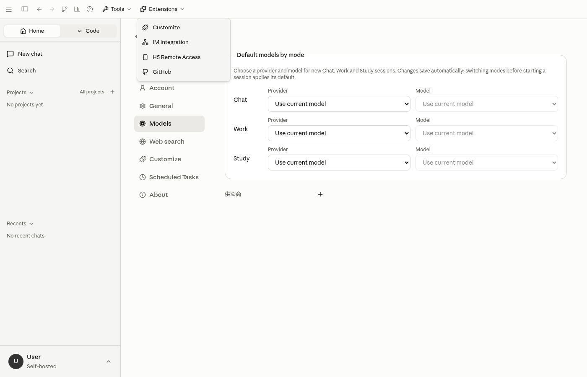
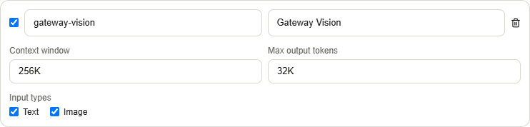
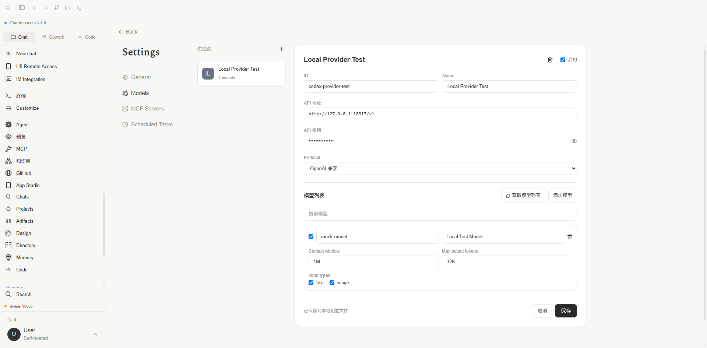
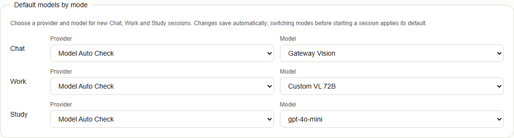
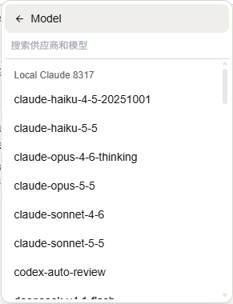
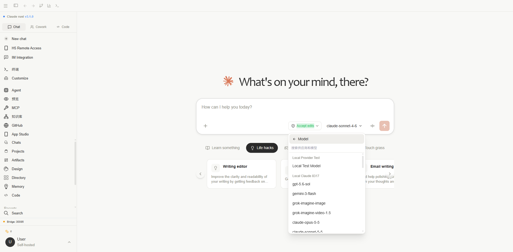
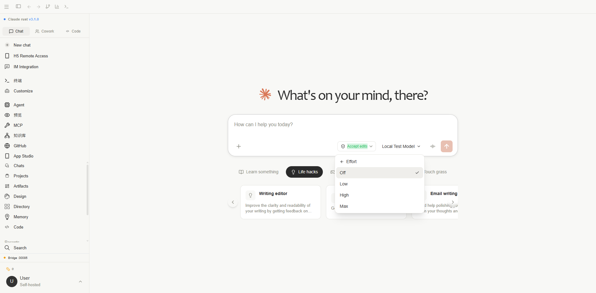

# 模型供应商与会话模型

在原有 **Settings → Models** 页面管理供应商。页面不再显示“对话模型”的 Opus / Sonnet / Haiku 档位分配；新建会话直接按供应商选择已启用的模型。

## 添加供应商

点击供应商列表旁的加号，选择以下一种类型：

- **第三方模型供应商**：目录取自本机安装的 DeepSeek Harness，使用 `@earendil-works/pi-ai@0.85.1` 的公开元数据，共 40 个供应商、1354 个模型。选择供应商后带入地址、原生协议和模型参数；不读取 Harness 中保存的私人凭据。
- **自定义模型 API**：填写 ID、Name、URL、API Key 和 Protocol。协议支持 OpenAI 兼容与 Anthropic。API Key 显示在 URL 下方，默认遮挡。ID 保存后固定，名称和连接参数可继续修改。已保存供应商的顶部 Name 可直接编辑，点击旁边的“保存”即可更新名称。

自定义地址使用服务根地址或 `/v1` 基础地址，例如 `http://127.0.0.1:8317/v1`。先保存供应商，再点击“获取模型列表”；也可以直接手动添加模型。获取列表后点击“保存”应用变更。



## 单独配置模型

每个模型可编辑 ID、显示名称、启用状态、Context window、Max output tokens，以及 Text / Image 输入类型。

Token 数量接受正整数与 K / M 写法，例如 `256K`、`1M`、`1.5M`，分别代表 256000、1000000、1500000。输出上限不得超过上下文窗口；从目录初次载入时，超过窗口的输出上限会缩减到窗口大小。未指定输出上限时，后端使用 8192。

模型 ID 是实际发送给供应商的标识，名称只用于显示。Text / Image 控制输入能力，不代表支持生成图片。上下文检查使用估算 Token 数量，最终仍以供应商的实际限制为准。

修改模型 ID / 名称或点击“获取模型列表”时，会自动识别 Text / Image 输入能力、上下文和已知输出上限：接口明确返回的参数优先，其次参考内置模型目录，再按名称中的 Vision / VL / Multimodal 与 K / M 上下文标记补全。支持带供应商前缀、日期、latest / thinking 后缀的已知模型；72B 等参数量不会被当作上下文。未知上下文留空，仍可手动调整。

获取列表会更新旧的 text 默认值和已识别限制，保留模型显示名称和启用状态；接口明确返回 text-only 时不会因名称推断开启 Image。接口未提供参数且模型未知时，保留已有手动参数。保存后才写入本地配置。





## 新建会话与 Effort

### Chat / Work / Study 默认模型

在 **Settings → Models** 顶部的“各模式默认模型”中，分别选择 Chat、Work、Study 的 **Provider** 与 **Model**。修改后自动保存；新会话以及开始会话前切换模式时，使用对应默认模型。已有会话保留其已保存模型；会话中仍可通过模型菜单单独修改。

只可选择已启用的供应商和模型。默认供应商或模型被删除、禁用后，会显示“不可用”，新会话回退到可用选择；不同供应商下相同模型 ID 仍通过 provider/model 组合精确区分。选择“使用当前模型”可清除该模式的固定默认值。

桌面端保存到 `general-settings.json`，浏览器开发环境保存到 `general_settings` localStorage；两种环境的偏好独立。



### 模型菜单

点击输入区的模型按钮，在 **Model** 子菜单中按供应商选择模型。即使两个供应商有相同模型 ID，请求仍携带独立的 `provider_id` 与 `model`，准确选中对应地址和密钥。

每个供应商组内的模型按显示名称升序排列，忽略大小写并按数字自然顺序比较，例如 `gpt-2` 在 `gpt-10` 前；搜索后保持同样顺序。



**Effort** 子菜单提供 Off、Low、High、Max；当前选择会保存在本机浏览器或 WebView 偏好中，发送消息时交给后端。

- 内置供应商使用 Harness 同版本协议适配器处理推理等级和原生工具消息。
- 自定义 OpenAI 兼容接口发送 `reasoning_effort`；Off 为 `none`。DeepSeek 官方地址同时设置 `thinking` 开关。自定义服务必须支持对应参数及等级。
- 自定义 Anthropic 新版 Claude 使用 adaptive thinking 和 effort；Sonnet 的 Max 映射到其最高支持等级 High。旧版模型使用受输出上限约束的 thinking budget。





## 本地保存与运行要求

桌面端和开发浏览器都通过 Rust 接口保存至：

```text
%APPDATA%\com.claude.desktop\config.json
```

配置包含供应商 API Key。旧浏览器 `app_providers` 数据会在首次成功连接后迁移，已有同 ID 文件配置优先；原缓存保留为迁移备份。保存失败会返回错误并回滚内存配置，不会显示成功。引擎发送时同步最新供应商配置，使用配置的输出上限与输入类型检查，并按上下文窗口进行后续压缩。

内置供应商运行依赖 **Node.js 22+**。开发和生产构建都会生成 `dist-runtime/provider-runtime.mjs`，Tauri 将其打包到 `runtime` 资源目录。自定义 OpenAI / Anthropic 接口继续由 Rust 直接请求。使用云平台环境认证的供应商还需要该平台的有效环境凭据；目录存在不代表账号自动获得模型权限。

开发浏览器连接方法见[浏览器调试](../development/browser.md)。验证范围与截图见[供应商功能验证](../development/providers-verification.md)。
