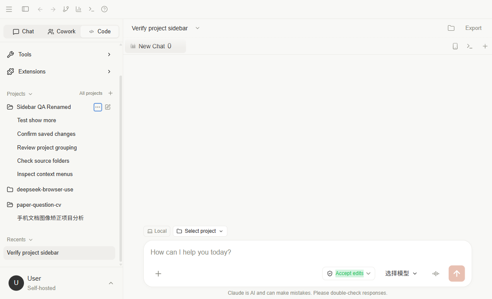
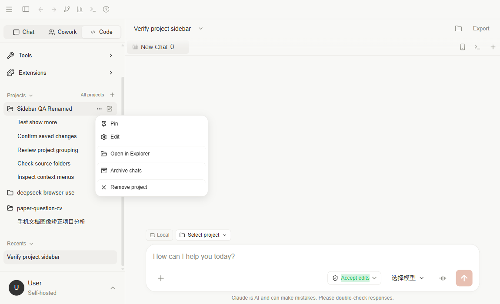
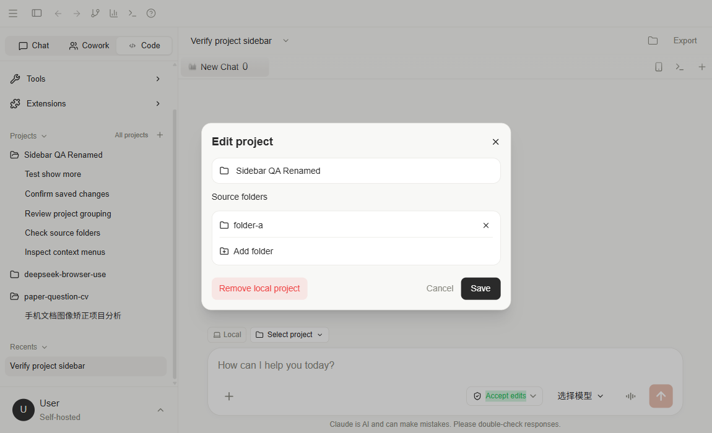
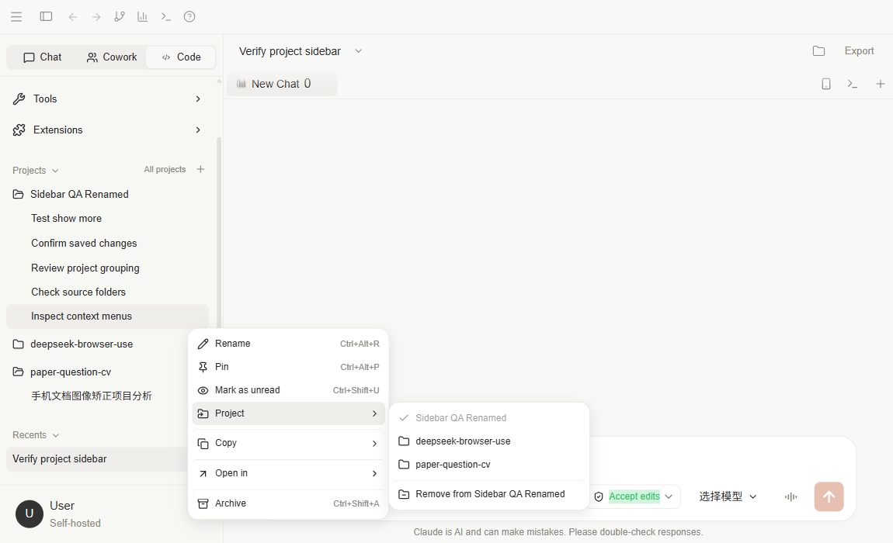
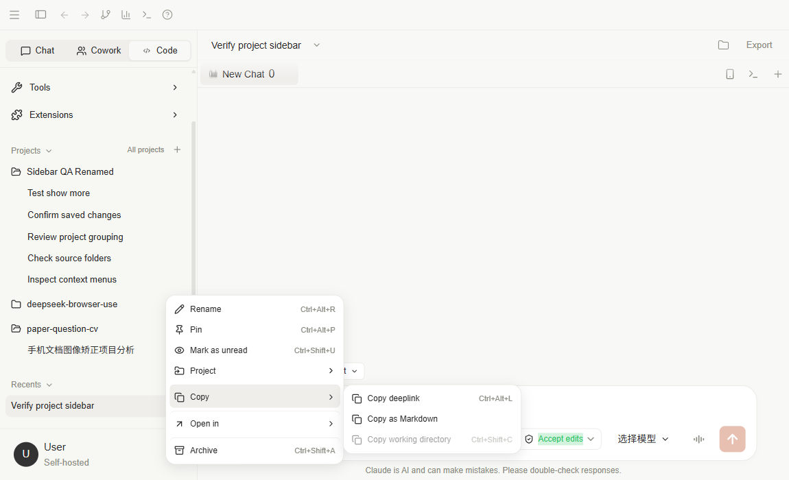
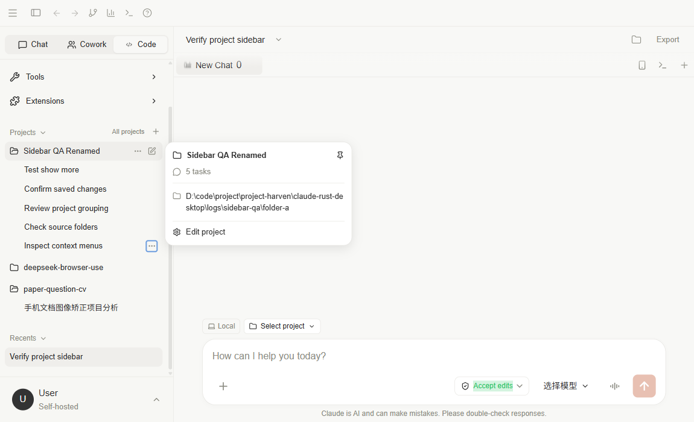
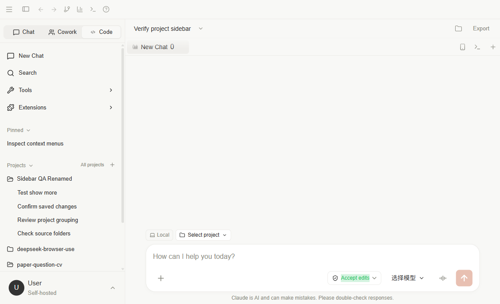
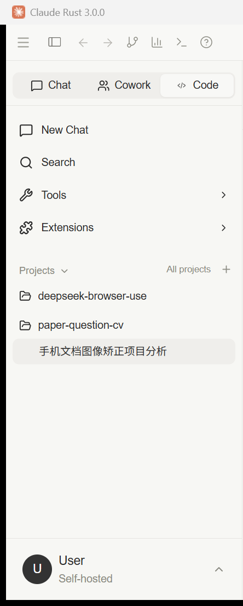

# 侧栏项目管理验证

验证日期：2026-10-13。应用通过 `npm run tauri -- dev` 启动。浏览器检查使用指定 deepseek-browser-use 项目的 dsb，任务 `202610132033`，会话 `projects-sidebar`，Chrome 回执确认 `headless=false`。

## 实现与验证范围

- Projects 展开后，项目行不缩进；展开项目后的会话缩进 24px。
- All projects 位于 Projects 标题右侧、创建按钮左侧。
- 侧栏移除 Explorer；Recents 会话左对齐，无前置文件夹图标或额外缩进。
- 项目详情浮层、项目菜单、项目名称与多目录编辑、独立 Pinned 分区、会话菜单及 Project / Copy / Open in 二级菜单。
- 会话固定与归档写入 SQLite；项目固定、折叠与未读标记保存在客户端。
- 会话修改检查后端错误，单次修改使用数据库事务，失败时回滚。
- 本地 Vite 调试页通过代理读取和修改同一个桌面后端的会话，避免浏览器只更新本地缓存。

## 自动检查

- `npx tsc --noEmit --pretty false`：通过。
- `npm run test:run`：47 项通过，其中 11 项新增侧栏测试覆盖分组、标题操作入口、快捷键、固定失败、移动及解除关联、未信任目录、编辑取消、多目录保存、归档范围、移除确认、未读状态和完整 Markdown 复制。
- `npm run build`：通过。构建仍提示已有的大体积 bundle。
- `tauri dev` 完成 Rust 编译并启动窗口，桥接服务在本机运行。现有 Rust 编译警告与可选 MemEx 后端缺失提示仍存在。

## 可见浏览器与真实数据库

使用两个临时项目、六条空会话和两个临时目录验证，没有调用模型或编辑真实项目文件。

验证完成后已删除两个临时项目和六条测试会话，读回确认测试记录剩余数量均为 0。文档站构建也已通过。

1. DOM 几何回读确认：Projects 标题与项目行内容起点均为 16px；项目会话相对项目行缩进 24px；Recents 会话缩进为 0px。
2. 从菜单固定会话后，后端详情返回 `pinned=true`；重新加载页面后 Pinned 区仍显示会话。
3. 编辑项目名称，保存后重新读取后端确认名称更新。
4. 从 Project 子菜单移动会话，后端项目 ID 和工作目录同步变更，固定状态保留。
5. 从项目菜单归档会话，原项目五条会话均变为已归档；此前移出的会话仍未归档。
6. 确认移除项目后，项目消失，会话记录仍在，项目和工作目录关联清空；磁盘临时目录仍存在。
7. 提交“固定并移动到不存在项目”的组合修改被拒绝；读回固定状态确认事务回滚，没有部分保存。
8. 在 1150×700 视口检查主菜单和 Copy 子菜单，两个菜单边界都在视口内。截图均为视口截图，未发生截图降级。
9. All projects 已移动到标题行，Explorer 不再存在，Recents 会话保持左对齐。

浏览器测试中曾有一次按角色名称的宽泛匹配命中同名内容，并有一次菜单因自动滚动关闭导致动作超时。已改用明确选择器和状态回读；菜单随锚点滚动重新定位，随后复测通过。没有把超时动作记为成功。

## 截图

截图中的 Sidebar QA 项目与英文会话均为本次临时验证数据。

清理测试记录后的原生 Tauri 侧栏局部截图：

## Recents 与跨模式项目会话回归修复

同日后续反馈发现两个过滤问题：已关联项目的会话被排除在 Recents 外，且空列表会隐藏整个分区；项目会话按当前模式过滤，导致 Chat 无法展示 Code 创建的项目会话。

修复后：

- 三种模式始终显示 Recents，空列表显示 No recent chats；已关联项目的当前模式会话也列入其中。
- Projects 展示项目下所有模式的未归档会话，包含固定会话；空项目展开后显示 No chats in this project。
- Pinned 仍是当前模式的固定会话快捷入口，固定不会让会话从所属项目中消失。
- 新增 8 项回归用例，侧栏组件共 19 项测试通过，全套共 55 项通过；类型检查通过。

本次可见浏览器启动被自动审批拒绝，仅返回 blocked by policy，没有提供详细原因，未进行新的浏览器复测。上方截图保留首次实现时的验证记录，不能用作本次回归修复的截图证据。

## 边界

浏览器检查覆盖真实 React 页面和 Rust HTTP 后端。原生目录选择器、系统文件资源管理器打开和 Tauri 原生剪贴板调用沿用已有 IPC 能力，本轮未通过浏览器验证这些系统窗口。复制会话链接提供当前应用地址与会话路由，不新增操作系统自定义协议注册，也不提供跨设备会话分享。

操作说明见[项目与文件工作流](../usage/projects.md)。
