# 侧栏与项目工作流验证

项目右侧新建会话导致重复工作区栏的问题已修复，原因及可见浏览器前后对比见[重复工作区栏验证记录](../maintenance/project-new-chat-workspace.md)。

## 创建默认名称与 Chat 自动选择（2026-10-14）

- 创建弹窗允许名称为空或仅含空格，提交时使用第一个所选文件夹名称；显式输入的名称优先，并去除首尾空格。多个目录时，以当前列表的首个目录为准。
- 侧栏及项目总览创建成功并确认文件夹信任后，进入 Chat，重置会话后再选中新项目。路由携带的选择只消费一次，后续手动切换项目不会被覆盖。聊天框内创建继续使用已有选择流程。
- 取消信任仍保留项目，但不会自动进入项目聊天。
- 相关 5 个测试文件共 52 项通过，覆盖 Windows、Unix、UNC、中文目录、尾部分隔符、手动名称、多目录调整、创建入口跳转，以及与上次 Code 项目恢复逻辑的交互。
- `npx.cmd tsc --noEmit`、`npm.cmd run build`、`git diff --check` 均通过。构建仍提示部分产物超过 500 kB。
- 本次使用 Vitest 组件及路由测试，未执行浏览器或原生桌面端测试，未新增截图。以下记录为此前版本的验证结果。

验证日期：2026-10-13。应用通过 `npm run tauri -- dev` 运行。

## 实现范围

- 侧栏顶部保留 Chat、Cowork、Code；三个模式共用 New Chat、Search、Tools、Extensions、Projects、Recents，移除 Recents 内搜索框。Cowork 的 Swarm Collaboration 和 Code 的文件浏览器分别置于 Recents 列表下方。
- 侧栏、项目页和聊天框共用项目创建流程，必填名称与至少一个本机目录。
- 项目创建后提示信任；取消不授权。目录与信任状态保存在 SQLite。
- 聊天框支持选择已有项目、新建项目、增删项目目录；后端也禁止空目录列表。
- 新增目录不继承已有目录的信任，移除后重新添加需要再次确认。
- 聊天引擎在发送前检查项目目录信任，以首个目录作为工作目录，并加入其他源目录路径和项目说明。

## 已完成的检查

- `npm run build`：通过。
- `npx tsc --noEmit --pretty false`：通过。
- `npm run test:run`：20 项通过，包含 4 项新增项目交互组件测试。原有国际化测试有 React `act(...)` 提示。
- `cargo test --lib db::project_repo::tests`：4 项目录持久化与信任测试通过。
- `python scripts/test-project-workflow.py`：通过正在运行的 Tauri 后端及 Vite 本地代理验证真实 HTTP 请求。覆盖必填校验、多目录创建、未信任拒绝、逐目录信任、项目聊天关联、新增目录信任重置、至少一个目录、非法更新回滚，以及关联聊天工作目录同步。

HTTP 验证仅创建临时目录、测试项目及空会话，不调用模型；测试完成后已清理这些测试记录。

## 可见浏览器复测（2026-10-13）

此前启动命令曾被自动审批检查拒绝，仅返回 `blocked by policy`。用户手动重新打开桌面应用后，本次通过指定的 deepseek-browser-use 项目成功建立可见 Chrome 会话（任务 2026101311，session 为 sidebar-projects-recheck，headless=false），访问 http://127.0.0.1:5200。此次启动和测试没有出现策略拒绝。

已通过真实页面交互确认：

- 空创建表单的提交按钮禁用；填写名称并添加两个临时目录后可创建项目。
- 创建后显示两个目录的信任提示；取消后项目保留，再从聊天框选择时仍要求信任。
- 确认信任后聊天框显示项目名及两个目录。
- 添加第三个目录并保存后，仅对新增目录请求信任。
- 依次移除目录后，最后一个目录的删除按钮禁用，提示 Keep at least one source folder。
- HTTP 回读确认最终目录及信任状态已持久化。仅删除本次 UI Verification 20261013 测试项目，并回读确认清理成功；没有发送模型请求。
- 顶部 Chat / Cowork / Code 已恢复；点击 Cowork 显示协作面板，点击 Code 显示 Explorer，返回 Chat 恢复六个区域。
- 恢复顶部入口后重新执行 TypeScript 检查、生产构建和 git diff --check，均通过。

以下五张图片均为 Chrome 页面视口截图，不是原生 Tauri 窗口截图。前三张拍摄于恢复顶部入口之前，后两张包含恢复后的入口布局；三个模式共用菜单的最新截图见下一节。

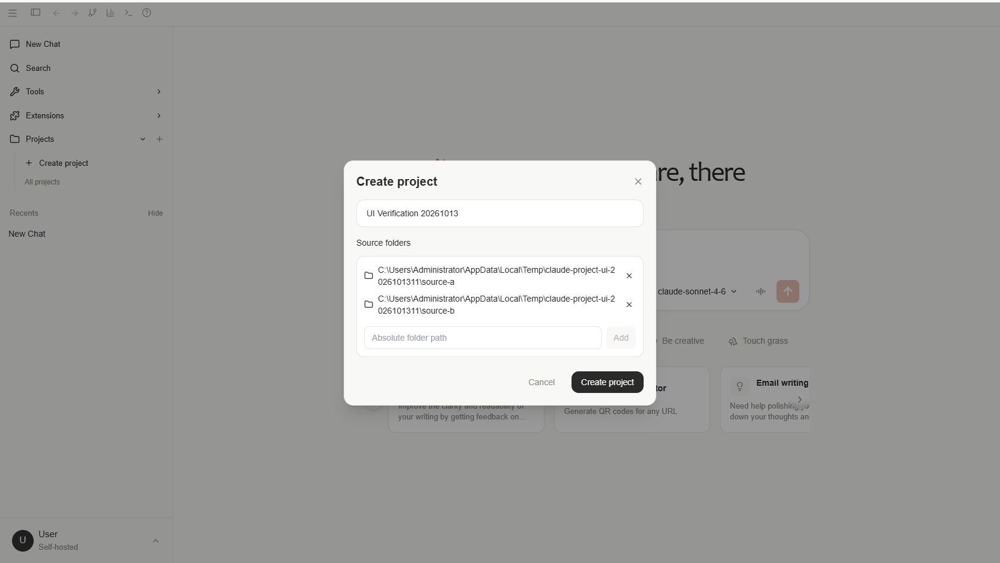

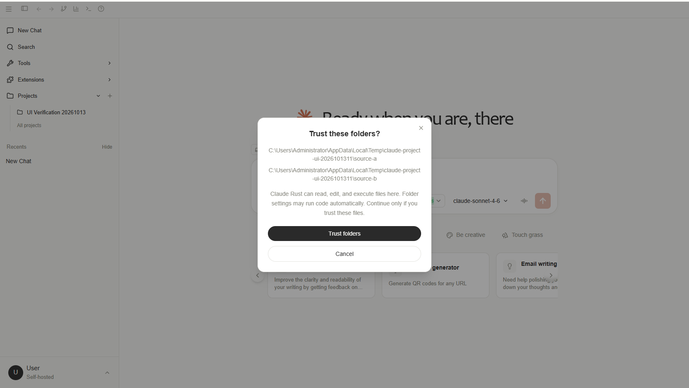

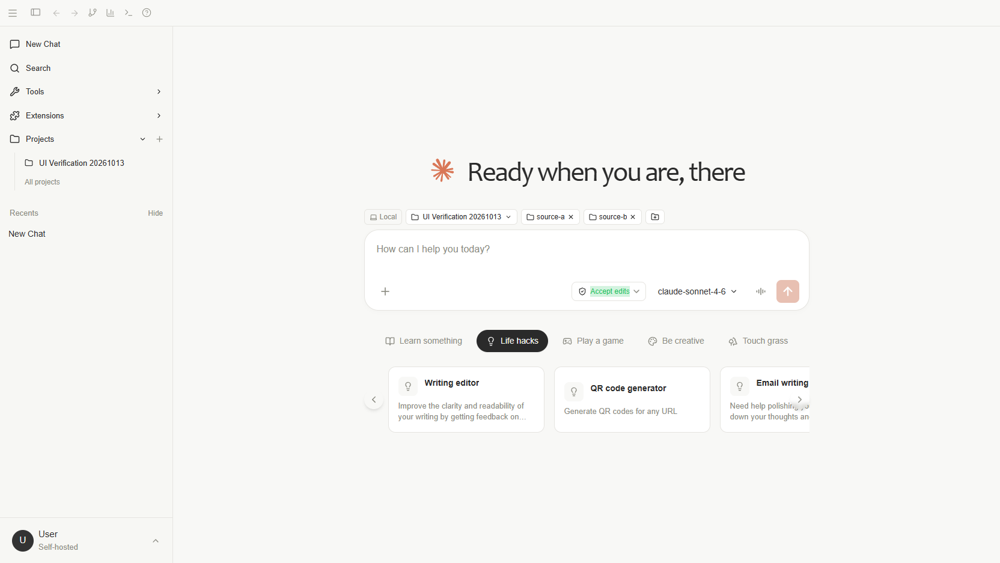

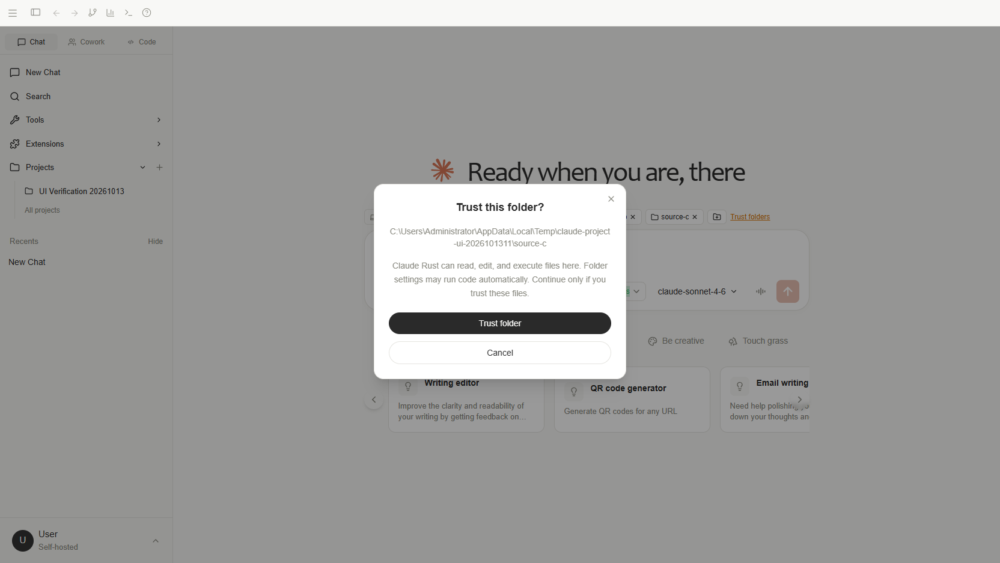

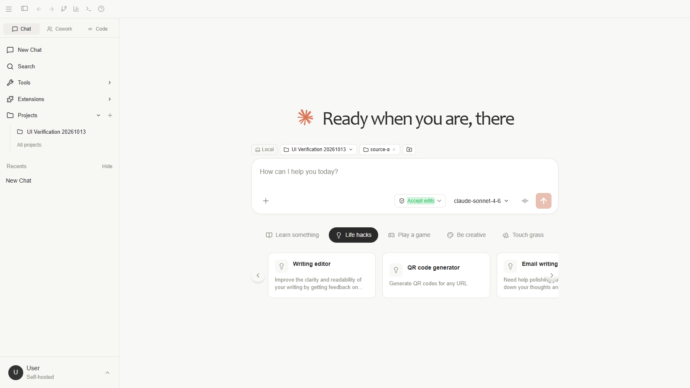

## 三个模式共用菜单复测（2026-10-13）

调整后通过同一可见 Chrome 会话依次切换 Cowork、Code、Chat。DOM 断言确认每个模式都有 New Chat、Search、Tools、Extensions、Projects 按钮及 Recents；Cowork 的协作面板、Code 的文件浏览器均位于 Recents 之后。三组断言通过，TypeScript 检查及 git diff --check 通过。此次仅测试菜单切换和布局，没有发起聊天或协作任务。

以下为浏览器侧栏元素截图，已检查菜单顺序和面板位置：

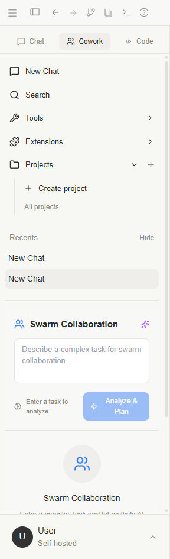

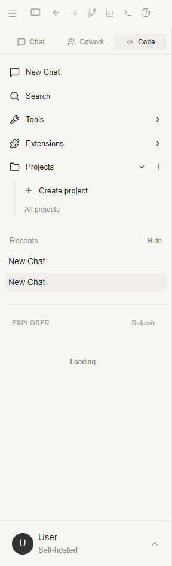

## Recents 按模式隔离复测（2026-10-13）

会话新增持久化字段 workspace_mode，取值为 chat、cowork、code。SQLite 旧库迁移将已有会话归入 Chat；浏览器本地会话也保存该字段。三个模式仅显示各自历史，折叠状态分别保存；项目会话使用创建时模式，分支会话继承原模式。

- 前端类型检查、生产构建、git diff --check 通过，Vitest 共 22 项通过。
- Rust workspace_mode_tests 两项通过，覆盖旧库迁移重复执行、旧记录保留、无效模式拒绝，以及数据库关闭重开后分类持久化。
- scripts/test-workspace-modes.py 通过运行中的 tauri dev 后端验证创建、列表、详情、默认分类、分支继承和项目会话分类。仅创建空会话和临时项目，结束后清理测试数据。
- 使用 deepseek-browser-use 可见 Chrome（任务 2026101312）通过应用 API 分别创建三个空测试会话；点击各模式后断言 Recents 仅含对应记录。刷新页面后再次逐个验证，全部通过。此部分覆盖浏览器本地存储，SQLite 由前述真实 HTTP 测试覆盖。
- 三个浏览器测试会话已删除，测试前的模式与折叠状态已恢复。没有发起模型或协作任务。

以下为最终侧栏元素截图，已检查分类及面板位置：

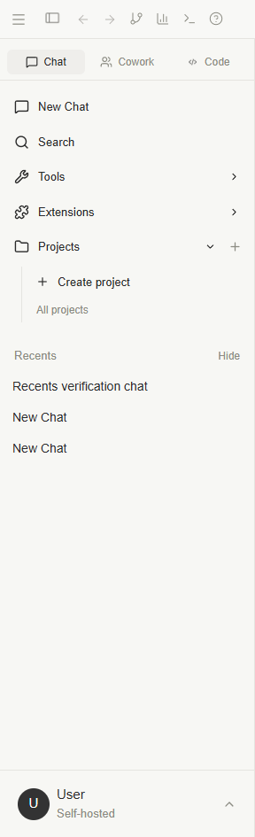

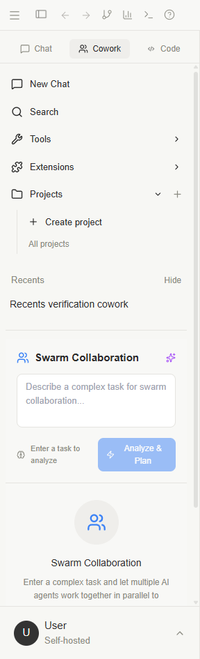

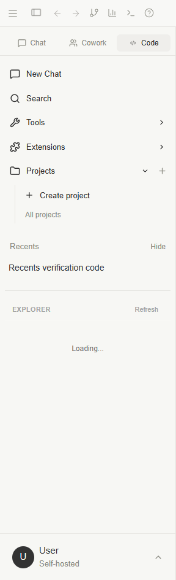

## Projects 菜单简化

已通过浏览器确认展开区不再显示 Create project 文本入口，右侧加号仍可打开创建窗口；All projects 的实际字号为 14px。

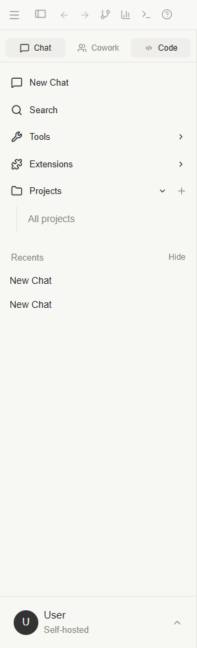

## 尚未验证的部分

普通浏览器无法覆盖 Tauri 原生目录选择器，本次通过绝对路径输入完成目录交互。Code 的 Explorer 面板已能切换显示，但本次观察时目录树仍显示 Loading，因此不能据此认定文件树加载或文件编辑通过。未测试模型执行、原生窗口布局及原生目录选择器。
