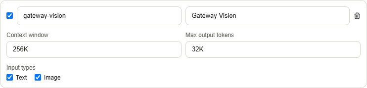
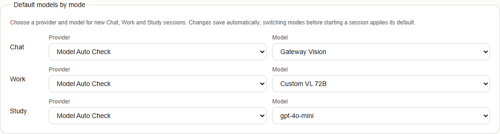
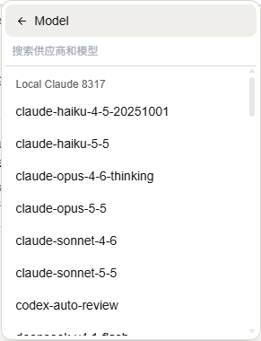
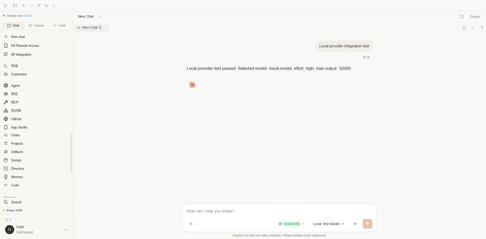
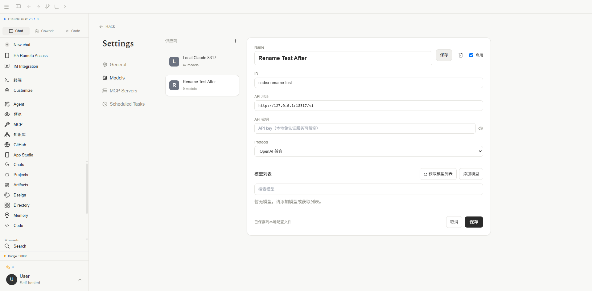

# 模型供应商功能验证

## 自动识别回归（2026-10-14）

通过指定项目的 `dsb/dsb.exe` 在可见 Chrome 中测试，任务 ID `2026101407`，确认 `headless=false`。临时供应商连接本机模拟 `/v1/models`，实际使用 Rust fetch-models 与保存接口。

- PASS：仅返回 ID 的 GPT-4o 从旧 text / 8192 配置补全为 Text/Image、128000；原禁用状态保留。
- PASS：嵌套 `architecture.input_modalities`、`context_length`、`top_provider.max_completion_tokens` 解析为 Text/Image、256000、32000。
- PASS：GPT-4o-mini 明确返回 `supports_vision=false` 和 `context_window="64K"` 时保持 Text、64000。
- PASS：自定义 `custom-vl-72b-256k` 识别 Image 与 256000；72B 不作为上下文。
- 点击页面保存后通过接口重新读回，5 项断言全部通过；完整数据见 [JSON 证据](../../assets/models-auto-fetch-check.json)。截图为单个模型卡片证据。
- Rust discovery 测试 2 项通过；前端相关测试、默认 TypeScript 检查、生产构建和差异检查通过，最终检查范围见下节。

范围：验证配置发现、推断、编辑和保存；未调用外部模型或验证真实视觉识别。测试临时供应商在收尾时删除。



## 模型升序与模式默认值回归（2026-10-14）

继续使用可见 Chrome 任务 `2026101407`，验证实际页面与 localStorage：

- PASS：Settings → Models 为 Chat、Work、Study 分别选择 Gateway Vision、Custom VL 72B、gpt-4o-mini；完整刷新后所有 provider/model 选项仍匹配保存值。见 [设置读回证据](../../assets/models-mode-defaults-check.json)。
- PASS：打开新会话，模型为 Chat 默认的 Gateway Vision；切换 Work、Study、Chat 后依次为 Custom VL 72B、gpt-4o-mini、Gateway Vision。
- PASS：模型菜单两个供应商组内全部模型升序，按显示名称忽略大小写、按数字自然顺序比较。见 [运行与排序证据](../../assets/models-mode-runtime-check.json)。
- 前端 11 个相关测试文件、88 项测试通过，覆盖同 ID 跨供应商选择、设置持久化、无效/禁用默认值回退、已有会话及旧模型 ID 保留、手动选择不被目录刷新覆盖、项目模型回归、多语言完整性及流式记录。
- 默认 TypeScript 检查、前端生产构建、文档生产构建通过。补齐所有支持语言的默认模型文案和原有设置缺失键；测试中读取最后一次调用改为兼容 ES2021 的索引写法。测试后恢复原模式默认值并删除临时供应商。

截图分别为默认模型设置区域与模型菜单区域；未发送测试聊天或调用外部模型。





验证日期：2026-10-13。环境：Windows、Chrome 可见窗口、Vite 5200、Rust Bridge 30085、Node.js 22.23.2。

浏览器操作通过 deepseek-browser-use 的 `dsb` 执行，任务 ID 为 `2026101302`。测试供应商指向本机 18317 端口的模拟服务，没有调用外部付费模型。

## 已验证结果

- Settings → Models 保留原设置页导航和整体布局，仅显示供应商配置；新增页面包含“第三方模型供应商”和“自定义模型 API”两类。
- 第三方目录显示 40 个供应商。目录共 1354 个模型，来源为本机 DeepSeek Harness 中的 `@earendil-works/pi-ai@0.85.1`。
- 浏览器创建临时自定义供应商，填写 ID、Name、URL、Key、OpenAI 协议。Key 在 URL 下方且遮挡显示。
- 模型设置输入 `1M`、`32K` 并选择 Text / Image，保存后本地 `config.json` 中分别为 `1000000`、`32000`、`supports_vision=true`。后端重启后重新打开页面，仍显示 `1M`、`32K` 和 Image 选中状态。
- 输入 `0` 时表单报告无效并显示“Token 数量超出有效范围”。Rust 拒绝输出上限超过上下文窗口的配置。
- 旧浏览器供应商 “Local Claude 8317” 及其 47 个模型迁移成功；测试结束保留该配置。
- 新建会话的模型菜单按供应商分组；Effort 菜单显示 Off / Low / High / Max。
- 浏览器选择测试模型和 High 后发送，模拟服务实际收到 `/v1/chat/completions`、`model=mock-model`、`reasoning_effort=high`、`max_tokens=32000`，测试鉴权匹配，页面显示流式回复。
- Rust HTTP 集成测试通过内置 DeepSeek 适配器发送 Max 并收到回复；创建另一供应商使用相同 `mock-model` ID 后，指定供应商 Low 请求成功。Image 禁用时请求被拦截，上下文预算不足时返回具体错误。
- 临时供应商和测试会话已清理。



## 自动化检查

- TypeScript 类型检查及前端生产构建通过。
- `src/utils/modelConfig.test.ts`：3 项通过，覆盖 K/M Token 解析、无效输入和供应商模型身份。
- `scripts/provider-runtime.test.mjs`：4 项通过，覆盖 Off / Low / High / Max、指定地址/鉴权/输出限制、系统消息、原生工具消息连续调用及图片内容转换；Max 同时验证打包后的 worker。
- Rust `provider_` 筛选测试：3 项通过，覆盖本地配置读写、覆写保存、保存失败回滚、配置校验、同名模型精确选择、禁用供应商及输入能力约束。
- 项目差异通过 `git diff --check`。

可复现的代码检查命令：

```powershell
npx.cmd tsc --noEmit --pretty false
npx.cmd vitest run src/utils/modelConfig.test.ts
node scripts/build-provider-runtime.mjs
node --test scripts/provider-runtime.test.mjs
cargo test --manifest-path src-tauri/Cargo.toml --bin claude-desktop-tauri provider_
npm.cmd run build
```

以上是验证当时的命令。之后 Rust 包改名为 `deepseek-code-desktop`（可执行文件 `dcd`），两个 `provider-runtime` 脚本已不在当前仓库中。现在在仓库根目录运行：

```powershell
npx.cmd tsc --noEmit --pretty false
npx.cmd vitest run src/utils/modelConfig.test.ts
cargo test --locked -p deepseek-code-desktop provider_
npm.cmd run build
```

## 验证边界

40 个目录供应商没有逐一连接外部生产服务。云平台身份认证、真实账户权限、计费、各模型推理等级支持范围仍由实际供应商决定。Windows 开发运行与 worker 打包已验证，未执行完整安装包安装回归。图片内容转换与能力校验已验证，未对每个远程视觉模型进行实际识图测试。

截图均位于文档仓库 `assets` 目录；截图不包含真实 API Key。

## 供应商重命名回归

在可见 Chrome 中打开已保存的临时供应商，将顶部 Name 从 `Rename Test Before` 修改为 `Rename Test After`，点击顶部“保存”。列表和本地 `config.json` 均读回新名称。TypeScript 检查与生产构建通过，测试供应商随后清理。


