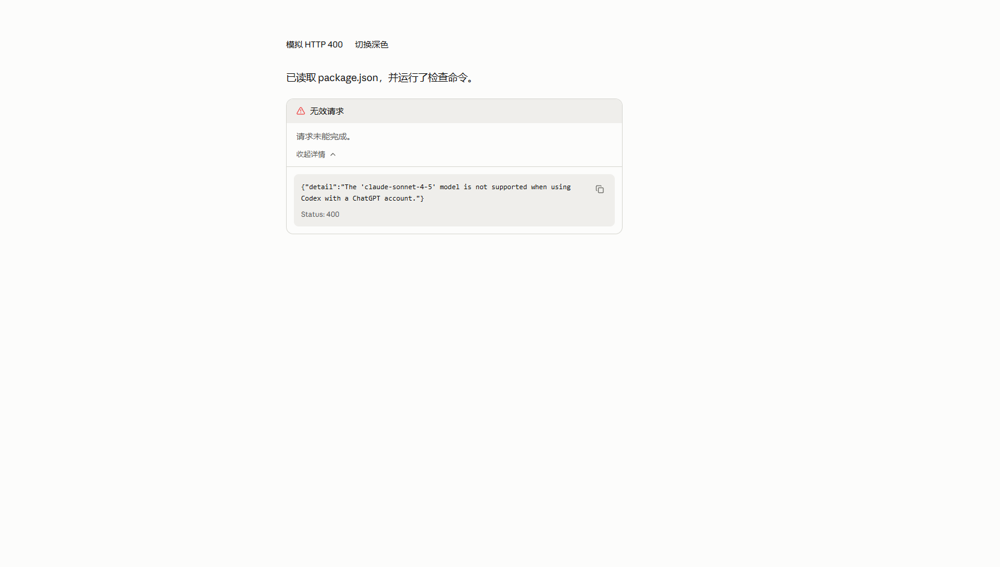
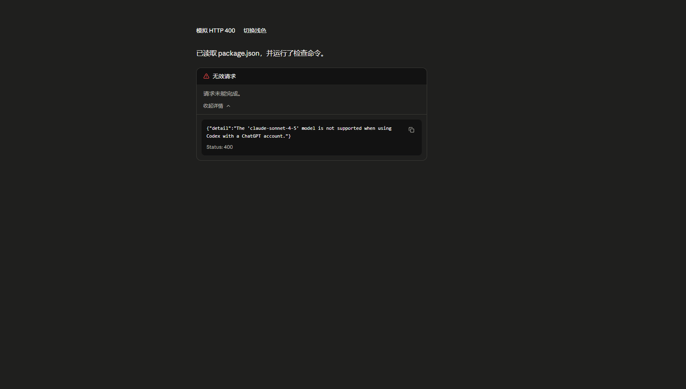

# HTTP 400 错误卡片验证

验证日期：2026-10-14。

## 行为

HTTP 400 在聊天回复区呈现“无效请求 / 请求未能完成。”卡片。详情默认折叠，展开后显示原始响应正文和状态码，并可复制。卡片使用应用已有主题变量，保留错误前的文本与工具记录。其他错误仍使用原有正文提示方式。

HTTP 请求入口保留状态码及响应正文；流式错误保留结构化错误和状态信息。错误卡片元数据随本地消息缓存保存。错误没有可识别的状态码时不会仅凭模型名称或正文数字猜测为 400。

## 自动检查

- TypeScript：`npx tsc --noEmit` 通过。
- 34 项相关测试通过，覆盖 HTTP 和 SSE 400、JSON/纯文本/空正文、非 400 排除、部分回复与工具记录保留、本地元数据恢复、详情展开收起和复制内容。
- `git diff --check` 通过。

## 可见浏览器验证

使用指定 deepseek-browser-use 的 Chrome 有头会话。页面为应用仓库的 `tests/ui/request-error.html`，导入真实 WorkDetails、错误卡片及全局样式；点击“模拟 HTTP 400”构造响应，经过实际响应读取和状态解析函数后展示。

- 默认折叠：通过，页面保留原有文本并显示无效请求卡片。
- 展开和收起：通过，原始 JSON 和 `Status: 400` 随详情显示和隐藏。
- 浅色与深色：通过，已查看两张完整视口截图，未见文本遮挡。
- 复制按钮：组件测试验证复制原始内容和状态码。浏览器首次操作遇到页面导航导致超时，回读状态并重新建立测试场景后，点击成功且出现复制反馈。

此次为模拟响应和真实组件验证，未向外部模型发起请求，也未验证打包后的原生窗口。截图为视口证据，不代表完整应用页面。

