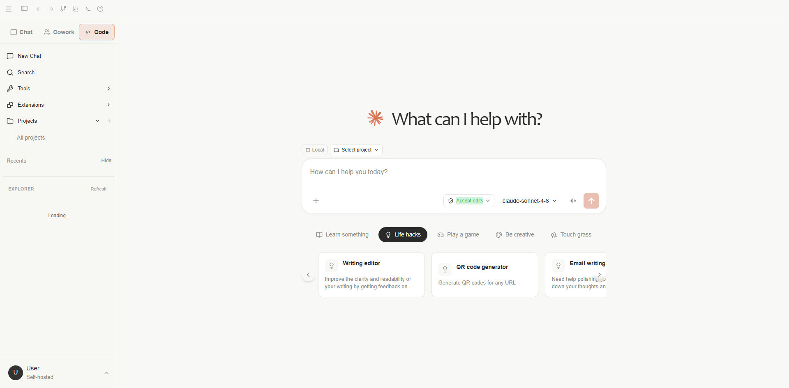
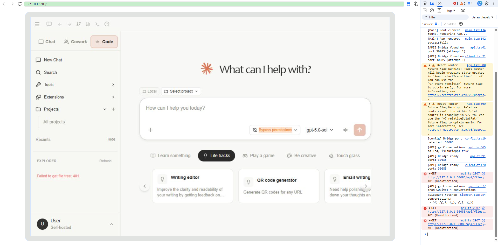

# 启动时 Sidebar 健康检查 401 验证

验证时间：2026-10-13，Asia/Shanghai。

## 结论与修改

原代码通过 `npm.cmd run tauri -- dev` 启动后，问题仍然存在。直接请求 `http://127.0.0.1:30085/api/health` 返回 401，响应为 `{"error":"Invalid or missing API key"}`；同一进程的 `/health` 返回 200，响应为 `{"active_sse_connections":0,"database":true,"status":"healthy"}`。

Bridge 在 `src-tauri/src/bridge/routes/system.rs` 注册的是 `/health`，认证中间件也只放行这个健康检查路径。`src/components/Sidebar.tsx` 中的请求误用了 `/api/health`。此次仅将该请求路径改为 `/health`。

`[API] getConversations from SQLite: 4 conversations` 是读取会话的普通日志，与健康检查认证失败无关。

## 实际验证

1. 保留原代码，用 `tauri dev` 启动原生窗口与 Bridge，确认错误路径返回 401、正确路径返回 200。
2. 使用指定的 deepseek-browser-use 仓库内 `dsb.exe`，以 `--browser chrome --headful` 打开可见浏览器。修改前控制台记录到 401。
3. 修改后重新加载浏览器页面，捕获由页面发起的 `/health` 请求：HTTP 200、`status: healthy`、`database: true`，该轮浏览器控制台未出现 401。
4. 停止首次开发进程，再次通过 `tauri dev` 启动。使用 dsb 控制的可见 DevTools 连接原生 WebView，确认 `window.__TAURI_INTERNALS__` 为 true。重新加载原生窗口并监听网络完成事件，捕获 `/health` 返回 200。
5. `git diff --check` 通过。此修改只涉及一个请求路径，未新增单元测试。

原生调试取证使用本机 9223 调试端口及 `devtools://devtools` 来源许可，仅设置于本次启动进程的环境变量，未写入项目配置。开发进程保持运行。

## 验证证据

- [修改前浏览器控制台](../../assets/sidebar-health-before-console.json)
- [修改后浏览器健康响应](../../assets/sidebar-health-after-response.json)
- [修改后浏览器控制台](../../assets/sidebar-health-after-console.json)
- [原生窗口重新加载的健康请求](../../assets/sidebar-health-native-reload.json)
- [原生环境确认与剩余错误](../../assets/sidebar-health-native-final.json)

下图是浏览器页面视口，不是原生窗口截图。

下图是连接原生 WebView 的 DevTools 视口，可见的剩余 401 属于文件树接口。

## 仍存在的独立问题

原生窗口控制台仍记录 `GET /api/filesystem/tree` 返回 401，界面显示 `Failed to get file tree: 401`。此次健康检查路径修正没有解决该文件树认证问题，因此不能将本次结果描述为“所有启动错误均已消除”。
