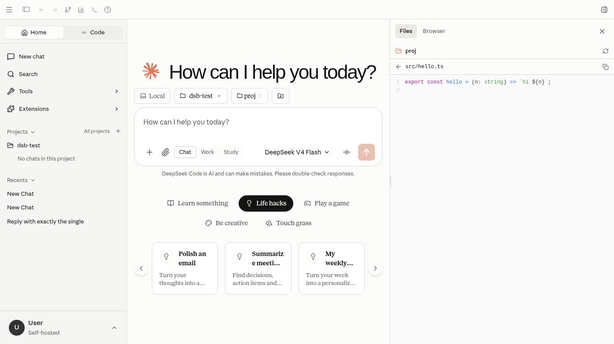
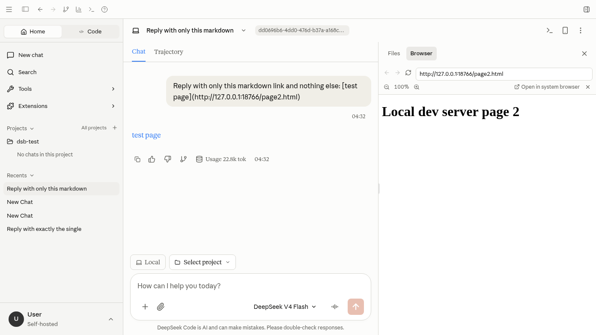
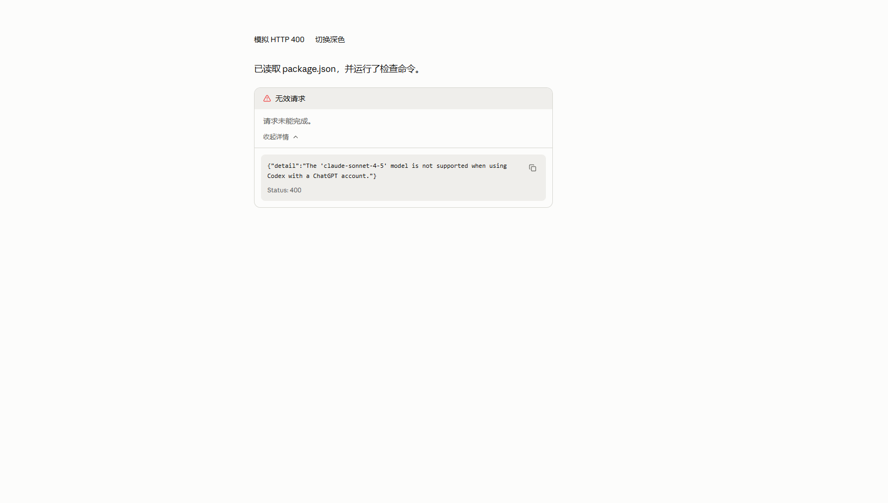
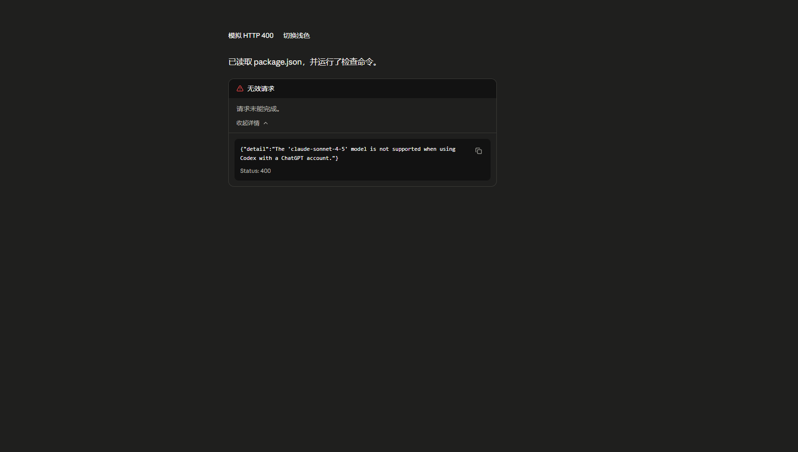

# 聊天与会话

聊天前先完成[模型配置](../configuration/models.md)。阅读文档无需启动模型服务。

## 发送第一条消息

1. 新建会话，确认供应商和模型。
2. 输入明确的小任务，例如“把下面三点整理为一段说明”。
3. 按当前设置的发送快捷键提交。
4. 查看内容是否逐步出现，以及工具请求或错误提示。

回复支持 Markdown、代码、数学公式和图表等渲染。代码显示不代表已执行；工具执行有自己的调用记录。

## 阅读流式回复

回复生成时，新到达的正文逐步显现，代码、链接和公式保留各自的格式。历史消息不会重新播放整段逐字效果；停止生成或回复结束后，已收到的内容仍可阅读。系统开启“减少动态效果”时，正文不使用模糊渐显或等待动画。

停留在会话底部时，新内容会继续跟随显示。向上翻阅历史后，不会因为回复继续生成而强行拉回底部；主动回到底部后恢复跟随。切换会话会重新建立该会话的滚动状态。

长代码块可以展开或折叠；在同一代码块继续生成时，已选择的展开状态会保留。思考或工具详情也可展开阅读，收起后其内部控件不会进入键盘 Tab 焦点顺序。复制后的成功提示会短暂显示，不代表代码已执行。

聊天区随浅色或深色主题调整层次。输入区聚焦时显示双环提示，键盘导航也有可见焦点。字体和字号仍使用[偏好设置](../configuration/preferences.md)中的选择。

## 整理会话

历史会话用于回到之前的上下文。切换前确认当前任务是否仍在执行；重新进入后检查消息与模型信息。

恢复会话时，当前模式存在同名可用模型即可继续使用，不会仅因供应商前缀不同提示切换。CLI 生成的话题名称会保存为会话标题；旧的默认 CLI 标题在列表中使用首条用户消息作为可读名称，手动命名保持不变。

Code 模式没有选择项目时也可以发送消息，文件工具使用该会话自己的工作目录。选择项目后使用已信任的项目目录。

会话管理包含更新、删除和导出相关入口，但部分导出路径路由到网关，不能假定所有模式下都完全离线可用。删除前保留需要的内容，备份见[数据维护](../maintenance/data.md)。

## 提供上下文

说明目标、材料和结果格式。长期任务放入项目并补充项目说明，可复用流程整理成 Skill。

添加文件后核对输入区是否显示附件或上下文。不要仅凭本地文件存在就认为模型已读取它。

## 使用工具

确认目录与[权限模式](../configuration/permissions.md)，查看实际调用。失败时区分模型请求失败、权限拒绝和工具本身失败。

任务仍在处理时避免重复发送。若停止操作可用，使用后仍应确认后端任务是否结束，不只看动画。

## 右侧边栏

聊天页（首页与会话）标题栏右上角的面板按钮或 `Ctrl+Alt+B`（macOS 为 `⌘⌥B`）打开右侧边栏。拖动左边缘调整宽度；打开状态、当前标签和宽度会被记住。打开文档预览或产物列表时它们暂时占用右侧，关闭后侧边栏恢复。设置、项目等整页界面不显示侧边栏。

**文件**：显示当前会话的工作目录；会话没有目录时用所属项目的目录，首页用输入区选中的项目。目录逐级展开，支持方向键、Enter 和 Home/End。点击文件以只读方式查看，可复制路径。超过 1 MB 或二进制文件只显示大小，不读取内容。一轮回复结束后自动刷新，也可手动刷新。

**浏览器**：在地址栏输入网址，或点开始页里的本地开发地址（`localhost:5173` 等）。只接受 `http`、`https`；本机和局域网地址自动补 `http://`，其他补 `https://`。设置中“打开聊天链接”选择应用内侧边栏时，聊天里的链接也在这里打开。

页面在沙箱 iframe 中运行，不能调用应用的原生接口。桌面窗口只允许嵌入 `localhost`、`127.0.0.1` 和 `https` 页面；局域网 `http` 地址和普通 `http` 网站会被拦截。很多网站禁止被嵌入，空白时使用“在系统浏览器中打开”。

## 检查结果

模型请求返回 HTTP 400 时，回复区域显示“无效请求”卡片，并保留此前的回复与工具记录。点击“查看详情”可以展开原始错误内容和 `Status: 400`，右侧复制按钮复制错误内容及状态码。卡片跟随当前浅色或深色主题。

图片来自真实组件的浏览器模拟验证页面，详见[验证记录](../maintenance/request-error-card.md)。

文本完整、没有悬挂的工具步骤，切换后消息仍可访问。涉及文件修改时检查实际变更；涉及外部服务时检查返回结果。

无回复或一直加载，依次检查供应商、Rust Bridge 和模型错误，见[故障排查](../development/troubleshooting.md)。
