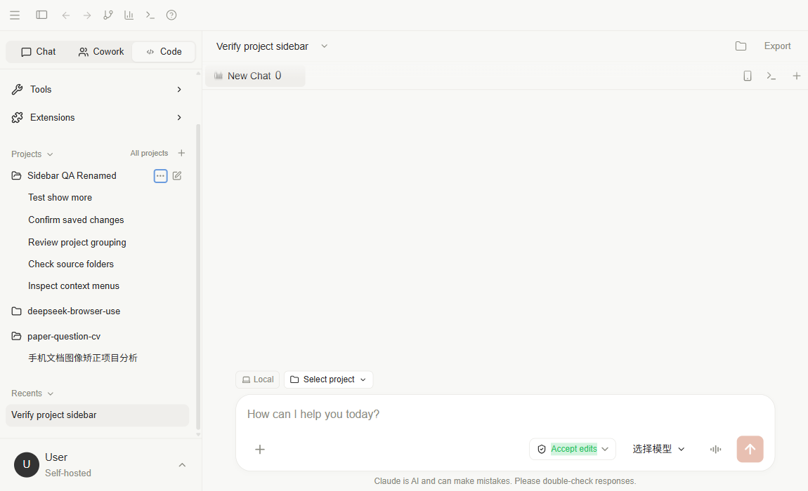
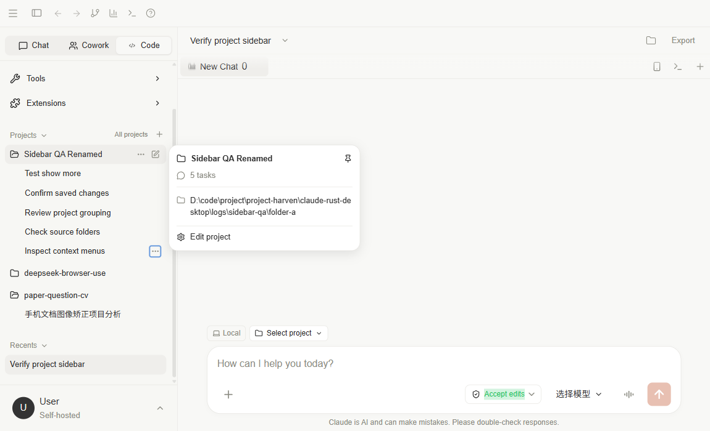
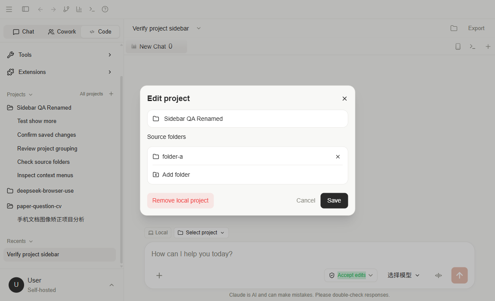
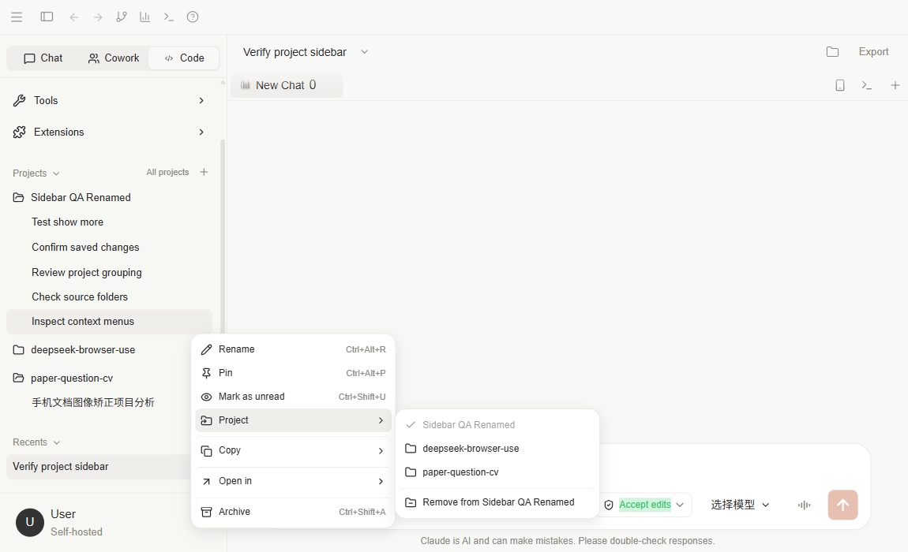
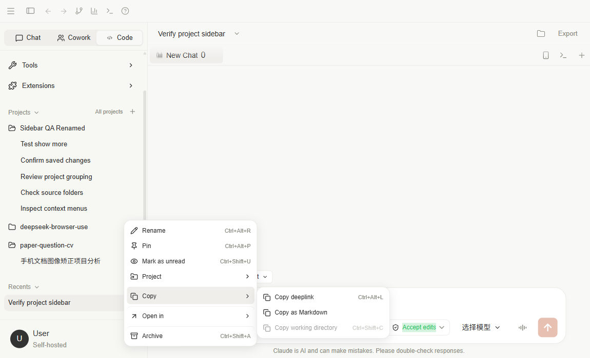

# 项目与文件工作流

项目适合保存持续任务的目标、说明和上下文，例如代码仓库或一组研究材料。

## 建立项目

侧栏顶部固定显示模式切换、New Chat 和 Search，账户入口固定在底部。Tools 和 Extensions 位于窗口顶部工具栏，收起侧栏后仍可使用。菜单支持方向键、Home / End 和 Escape；Escape 关闭菜单并返回原按钮。中间剩余空间由 Projects 和 Recents 各占一半，两区独立滚动。协作面板仍可从 Tools 打开。

会话按创建时的模式分类，分支会话保留原会话模式。没有模式信息的旧会话默认归入 Chat。切换模式不会改变会话所属项目，Recents 折叠状态按模式保存。

在 Projects 右侧点击加号，或在聊天输入框上方的项目菜单中选择 **Create project**。

1. 项目名称可留空；留空或只输入空格时，使用第一个所选目录的文件夹名称。手动填写名称时优先使用该名称。
2. 添加至少一个本机目录。桌面端可通过 **Browse folders** 多选，也可填写绝对路径后点击 **Add**。
3. 点击 **Create project** 保存。
4. 在随后出现的信任窗口中检查目录，再选择 **Trust folder / Trust folders**。
5. 从侧栏或项目总览创建后，自动进入 Chat 并选中新项目；从聊天输入框创建后，自动选择该项目。新聊天在发送首条消息时关联项目。

取消信任会保留项目，但不会授予目录信任。以后选择该项目时可以重新确认。未信任全部目录的项目不能发起项目聊天。

例如名称为“网站帮助中心”，目标为“维护中文用户说明”，项目说明写清读者、语气和目录规范，随后开始具体对话。

项目页提供搜索、不同排序方式和编辑信息等入口。

## 在侧栏管理项目与会话

Projects 标题右侧的 **All projects** 打开项目总览，加号用于创建项目。点击项目行展开或收起其未归档会话，包含不同模式下的会话；点击子会话才打开聊天。展开项目不会切换当前会话、改变草稿或筛选 Recents。每个项目默认显示五条会话，可用 **Show more** 展开其余记录。Projects 只列出实际项目，不显示 **No project**；没有项目时显示 **No projects yet**。未关联项目的历史会话仍可从 Recents 查看。

悬停项目显示名称、未归档任务数量、源目录路径和 **Edit project** 入口。项目右侧的更多菜单提供固定、编辑、在资源管理器中打开、归档项目会话和移除项目；新建会话按钮直接在该项目中创建会话。

**Edit project** 可以修改名称及源目录。新增目录仍需在使用前确认信任；项目至少保留一个目录。取消不会提交编辑内容。

**Recents** 独立显示当前模式分组中最近的未归档会话（Home 合并 Chat、Work、Study，Code 单独显示），不按展开或选中的项目过滤。按最后更新时间排列，缺少更新时间时使用创建时间；默认显示五条，点击 **Show more** 展开。固定会话保留在列表中，不额外占用第三个分区。空列表显示 **No recent chats**，标题与半区仍保留。打开会话后选择标记跟随该会话的项目；New Chat 保留当前项目供下次发送使用。项目固定、分区折叠和手动未读标记保存在当前客户端；会话固定与归档保存在数据库。

会话标题、工作区标签及 Chat / Trajectory 位于同一行；长标题截断显示，悬停可查看完整标题。标题下拉保留重命名、导出、删除，并提供 **Copy session ID**：复制完整的当前会话 ID，剪贴板实际成功后才显示成功提示，失败则提示重试。顶部工具栏的 Terminal 按钮与会话工具栏的 H5、竖向更多按钮已移除；会话 Terminal 按钮和 Tools 中的 Terminal 仍可打开统一右侧终端，H5 仍可从 Extensions 打开。

会话更多菜单支持重命名、固定／取消固定、标记已读／未读和归档。打开未读会话后清除手动未读标记。

- **Project**：移动到其他项目，或解除当前项目关联。移动后工作目录同步更新；移入未信任项目时先提示确认目录。
- **Copy**：复制会话路由链接、完整 Markdown 消息或工作目录。链接指向当前应用地址中的对应会话；仅持有链接不会分享本地会话数据。
- **Open in → File Explorer**：在桌面客户端中打开工作目录。未关联目录时入口禁用。

快捷键：重命名 `Ctrl+Alt+R`，固定 `Ctrl+Alt+P`，标记未读 `Ctrl+Shift+U`，复制会话链接 `Ctrl+Alt+L`，复制工作目录 `Ctrl+Shift+C`，归档 `Ctrl+Shift+A`。快捷键作用于当前会话或已打开菜单的会话；输入框和编辑弹窗中不会触发这些操作。

**Archive chats** 归档该项目所有模式下的会话；记录保留，可在会话总览中查询。**Remove project** 需要确认，只解除应用中的项目关联，会话保留，磁盘目录与文件不会被删除。

以上截图记录早期菜单样式，具体位置以当前界面为准：顶部提供 Tools / Extensions，侧栏 Projects 展开项目会话，Recents 独立展示最近记录。截图中的 Sidebar QA 项目与英文会话为临时验证数据；旧版验证结果见[侧栏项目管理验证](../development/projects-sidebar-verification.md)。

## 确认执行位置

聊天输入框上方显示 **Local**、当前项目和源目录标签。点击项目名称可以选择已创建的项目，或直接创建新项目。发送新聊天时，会话会关联到所选项目；已有聊天也可以更换项目。

Desktop 的 Code 模式发送前必须选择项目，并确认源目录信任。未选项目时发送按钮不可用，按发送快捷键会打开项目菜单并保留草稿；界面不显示常驻警告。New Chat 沿用已有项目选择。Home 的普通聊天仍可使用独立会话工作目录。

第一个源目录作为默认工作目录，其他源目录的完整路径会随项目上下文提供给模型。项目说明也会用于该项目的聊天。

## 添加和移除目录

点击聊天输入框上方的文件夹加号，编辑项目目录并保存。新增目录需要单独确认信任；已有目录的信任状态保留。

点击目录标签上的 **×** 可移除目录。项目至少保留一个目录，剩下最后一个时移除按钮不可用。移除首个目录后，下一个目录会成为默认工作目录。

目录变更属于项目，会影响关联会话后续发送时使用的目录。删除后重新添加的目录需要再次确认信任。移除目录只修改项目关联，不删除磁盘文件。

## 文件、终端与代码差异

文件浏览器查看文件，终端处理命令交互，差异视图检查建议修改，各自依赖后端与系统能力。

1. 确认目录和目标文件。
2. 让模型说明修改方案。
3. 按权限模式批准操作。
4. 查看差异和工具结果。
5. 运行相关项目检查。

消息显示差异不等于已落盘；应用后仍需检查实际文件。部分差异应用入口直接使用 IPC，普通浏览器需适配。

## 删除与备份

删除记录前确认关联资料的保留需求。不要假定删除记录等于删除磁盘项目，也不要假定一定能从 UI 恢复。

代码仓库应有自己的版本管理和备份，客户端数据库备份不能代替项目文件备份。

源码参考：`SidebarNavigation.tsx`、`ProjectsPage.tsx`、`features/project/`、`src-tauri/src/bridge/routes/projects.rs` 和 `crates/core/src/db/project_repo.rs`。

本轮实现的验证范围见[项目工作流验证记录](../development/projects-verification.md)。
