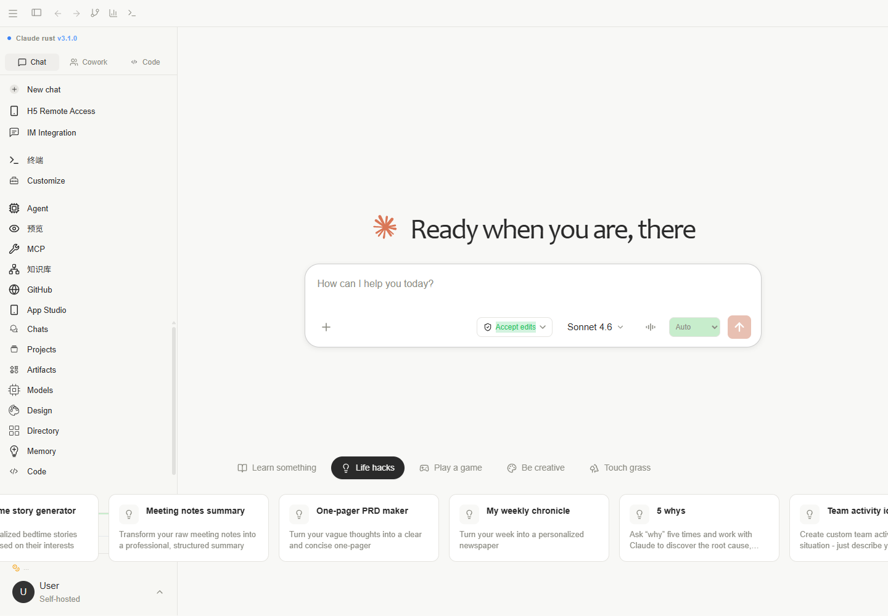

# 应用界面

DeepSeek Code Desktop 的主界面包含功能侧栏、会话输入区和模型选择入口。

- **功能侧栏**：进入聊天、项目、自定义和知识库等页面。技能、MCP、连接器和插件集中在“扩展 → 自定义”，设置中也有自定义入口。
- **会话输入区**：输入问题，选择模型与推理模式后发送。
- **模型配置**：通过设置中的 Models 添加供应商，并为对话选择可用模型。

开始使用前，请先完成[模型供应商配置](./configuration/models.md)。具体操作见[首次使用](./guide/usage.md)和[聊天与会话](./usage/chat.md)。

此图展示应用在浏览器中的主界面；原生桌面窗口的边框和系统控件因平台而异。
