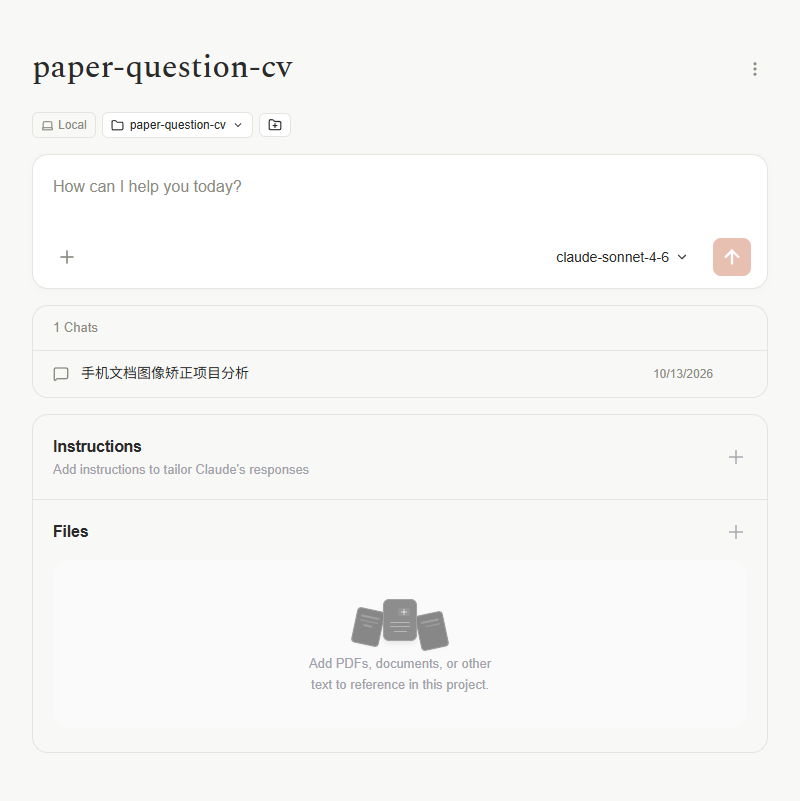
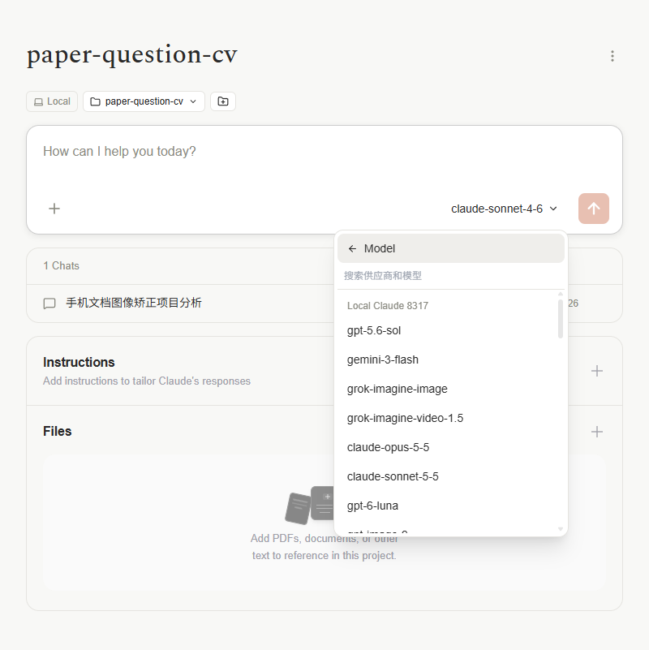

# Code 项目页与新聊天默认项目验证

验证日期：2026-10-13（Asia/Shanghai）。应用通过 `npm.cmd run tauri -- dev` 运行；浏览器验证使用指定 deepseek-browser-use 仓库的 dsb 客户端与可见 Chrome 窗口。

## 修改结果

- 项目名与唯一源目录同名时，Local 行只显示一个项目标签。悬停可查看完整目录路径，右侧目录按钮仍可管理源目录。多目录项目保留独立目录标签。
- 移除项目详情内容区的 All projects 返回按钮，将 Local 行放在项目标题下方、输入框上方。侧栏的项目列表入口仍可使用。
- 项目页复用聊天页的供应商模型目录。此前该页读取旧 `chat_models` 缓存，缓存为空时显示固定的 Opus、Sonnet、Haiku 三项，因而没有显示设置中的 47 个模型。
- 模型配置更新后列表同步刷新，只允许选用已启用的供应商和模型。创建项目会话时传递包含供应商标识的模型键；未配置可用模型时禁止提交。
- Code 模式记住上次显示或选用的项目。点击 New Chat 和重新加载页面后恢复默认选择；手动选择优先。已删除、已归档的项目不会恢复，临时连接失败不会清除记忆。恢复默认选择不会自动授予目录信任。

## 自动验证

以下命令运行通过，共 20 项测试，包含模型数量与提交参数、配置变更、空模型目录、托管模式，以及默认项目恢复、模式隔离、持久化、删除/归档、异步手动选择和目录信任流程：

```powershell
npm.cmd run test:run -- src/components/ProjectsPage.test.tsx src/features/project/projectWorkflow.test.tsx src/features/project/useLastCodeProject.test.ts src/stores/useWorkspaceModeStore.test.ts
npm.cmd run build
git diff --check
```

生产构建通过，存在打包体积提示。

## 实际页面验证

使用现有 `paper-question-cv` 项目与真实供应商配置，没有向模型发送验证消息：

1. 项目栏的项目名称只出现一次；详情内容区没有 All projects；标题、Local 行、输入框按上下顺序排列。
2. 供应商 Local Claude 8317 配置了 47 个已启用模型。项目页模型菜单实际包含 47 项，逐项名称核对通过。截图仅显示滚动列表的可见部分。
3. 点击 New Chat 后，待使用的项目 ID 与保存的上次 Code 项目 ID 相同，按钮显示 `paper-question-cv`。
4. 重新加载页面后，再次核对以上项目 ID 和按钮文本，恢复成功。

页面状态记录：

- [项目布局和配置数量](../assets/project-layout-models-check.json)
- [菜单内全部模型核对](../assets/project-model-menu-check.json)
- [New Chat 默认项目](../assets/code-new-chat-project-check.json)
- [刷新后默认项目](../assets/code-new-chat-project-reload-check.json)

以下图片是浏览器中的项目内容区域截图。





新聊天页的项目栏截图超时，一次强制探测也未成功，因此该项只有本轮页面状态记录，没有图片证据。创建会话时模型参数的验证使用模拟接口单元测试，未执行真实模型推理。
