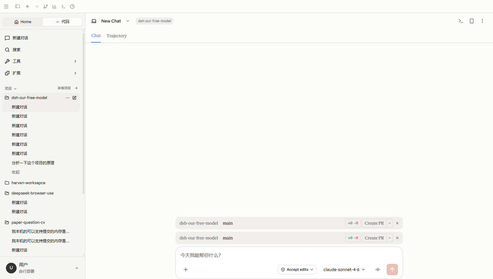
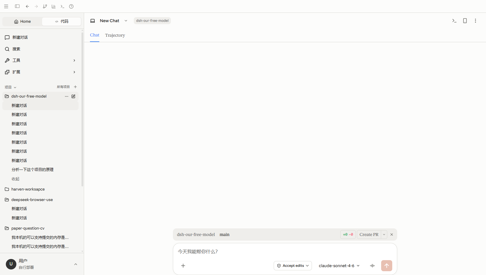

# 项目新建会话后重复显示工作区栏

验证日期：2026-10-14。

## 问题与原因

在 Code 模式打开已有用户消息的项目会话，再点击侧栏项目右侧的新建会话按钮，输入框上方可能出现两条相同的项目、分支和 Create PR 栏。

`MainContent.tsx` 的输入框容器同时渲染 `ConversationWorkspaceBar` 和 `SessionUsageBar`，两者都是直接子组件，之前都使用会话 ID 作为 React key。用量栏显示时 key 冲突，切换会话后旧工作区节点可能残留。浏览器控制台明确报告 `Encountered two children with the same key`。

现已分别使用 `workspace:<会话 ID>` 和 `usage:<会话 ID>`，既保留切换会话时重置组件的行为，也避免兄弟组件标识冲突。

## 可见浏览器验证

通过指定的 `D:\code\project\project-browser-use\deepseek-browser-use` 对应 dsb 服务，使用可见 Chrome（headless=false）访问 `http://127.0.0.1:5200`，连接真实本地后端。

- 修复前：首页直接创建、空会话之间连续创建均为一条工作区栏；从已有消息的项目会话点击新建后，DOM 中出现两个 Create PR 按钮，同时记录到重复 key 错误。
- 修复后：刷新页面，重新打开同一个已有消息的会话，再点击相同的新建入口。DOM 中只有一个 Create PR 按钮，重复 key 错误为零。
- 以下为本次 Chrome 视口截图，不是原生 Tauri 窗口截图。
- 复现创建的四个空会话已清理，并从会话列表回读确认不存在。没有发送模型消息。
- 相关 3 个测试文件共 30 项通过；`npx.cmd tsc --noEmit` 和 `git diff --check` 通过。

修复前：

修复后：

